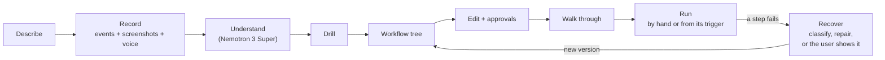
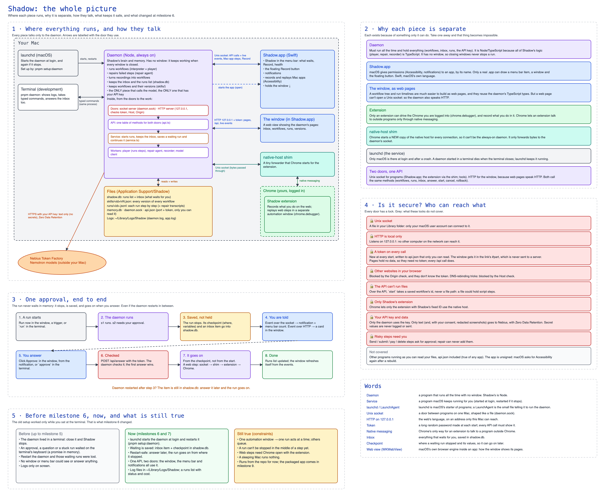

<p align="center">
  
</p>

<h1 align="center">Shadow</h1>

<p align="center">
  <b>Do a work task once. Shadow learns it, runs it for you, and repairs it when a site changes.</b>
</p>

<p align="center">
  <a href="LICENSE"></a>
  <a href="#nvidia-nemotron-on-nebius-token-factory"></a>
  <a href="#nvidia-nemotron-on-nebius-token-factory"></a>
  
  
  
</p>

<p align="center">
  <a href="https://akshat-soni02.github.io/nxn-global-ai-hackathon-personal-agent/">Website</a> ·
  <a href="#get-shadow">Download</a> ·
  <a href="docs/product.md">User guide</a> ·
  <a href="#nvidia-nemotron-on-nebius-token-factory">Nemotron on Token Factory</a> ·
  <a href="FEEDBACK.md">Feedback</a> ·
  <a href="DEVELOPMENT.md">Run from source</a>
</p>

---

You show Shadow a task the way you normally do it, and you can say what it is for. It works out the steps and asks about anything it is unsure of. From then on it runs the task by itself: on a schedule, when a file arrives, or when you start it.

Anything only you should decide waits in an inbox (send this? which file?). When a page changes, Shadow repairs the workflow instead of stopping. It runs on your Mac, is always on, and keeps its memory and your data there.

| 1 · You do it once | 2 · It runs on its own | 3 · It repairs itself |
| --- | --- | --- |
| Shadow records the task in Chrome, Mac apps and Finder. **NVIDIA Nemotron 3 Super** turns the recording into a workflow of about 10 named blocks, with loops, branches and connected-app steps, and asks only what is unclear. | The workflow runs on a schedule, when a file appears, or when you start it. Clicks and typing replay with **no model call**. An AI step (summarise, classify, pick) uses **Nemotron 3.5 Lightning**. Steps that send, submit, pay or delete wait for your OK. | When a page has changed, cheap fixes come first. Then the **repair agent** (Nemotron 3 Super) fixes the workflow and tries the fix on the live page. A fix that works is saved as the next version, and you can roll it back in one click. |

Built for the Personal AI track of the [Nebius x NVIDIA Global AI Hackathon](https://nebiusglobalaihackathon.devpost.com/). Shadow is an always-on, private assistant with persistent memory and reusable skills. Its models are **NVIDIA Nemotron** on **Nebius Token Factory**. It is open source under the [MIT License](LICENSE).

## Get Shadow

**[Download Shadow.dmg](https://github.com/Akshat-Soni02/nxn-global-ai-hackathon-personal-agent/releases/latest/download/Shadow.dmg)** · for Macs with Apple silicon (M1 or later), macOS 14 or later, with Google Chrome · [the website](https://akshat-soni02.github.io/nxn-global-ai-hackathon-personal-agent/) · [all releases](https://github.com/Akshat-Soni02/nxn-global-ai-hackathon-personal-agent/releases)

1. Open `Shadow.dmg` and drag **Shadow** to Applications.
2. Open Shadow. The first time, macOS stops it because Apple hasn't checked it: see [Opening an app Apple hasn't verified](#opening-an-app-apple-hasnt-verified) just below.
3. The setup window has three steps:
   - **Sign in** with Google. No API key is needed; afterwards you should see "Connected to Nemotron".
   - **Chrome:** load the extension, as the setup window shows. Chrome's Load unpacked picker can't open Shadow.app by clicking: press **⌘⇧G**, paste `/Applications/Shadow.app/Contents/Resources/extension`, press Return, then Select.
   - **Permissions:** Accessibility for Mac apps; Screen Recording and Microphone only for screenshots and narration.
4. Press **Open Shadow**. From then on Shadow starts when you log in. Press **Record**, do a task, press **Stop**.

Every screen, step by step: [`docs/product.md`](docs/product.md).

### Opening an app Apple hasn't verified

Shadow is open source and signed by us, but not notarised by Apple (that needs a paid Apple Developer account). So
macOS refuses it the first time, with *"Apple could not verify "Shadow" is free of malware"*. To open it once:

1. Open Shadow from Applications. When macOS refuses it, press **Done** (not Move to Trash).
2. Open **System Settings → Privacy & Security** and scroll down to **Security**. Next to *"Shadow" was blocked to protect your Mac*, press **Open Anyway**.
3. Press **Open Anyway** again and enter your Mac's password. From then on Shadow opens like any app.

On macOS 14 you can instead right-click Shadow in Applications, choose **Open**, then **Open** again. If macOS still
refuses, this removes the download mark macOS checks: `xattr -dr com.apple.quarantine /Applications/Shadow.app`.

Each new version is a new build, so macOS asks once more, and Accessibility (for Mac apps) has to be turned on again for it.

### Deployed link

- **Site**: [akshat-soni02.github.io/nxn-global-ai-hackathon-personal-agent](https://akshat-soni02.github.io/nxn-global-ai-hackathon-personal-agent/), on GitHub Pages, rebuilt on every push to `main`.
- **Download**: [the latest release](https://github.com/Akshat-Soni02/nxn-global-ai-hackathon-personal-agent/releases/latest): `Shadow.dmg` (the app, with the daemon and the Chrome extension inside) and `shadow-extension.zip`.
- **Service**: `shadow-api` on Google Cloud Run, redeployed by Cloud Build on every push to `main` that touches it; its URL is built into the app.

## Contents

- [Get Shadow](#get-shadow): download, [open an app Apple hasn't verified](#opening-an-app-apple-hasnt-verified), set up
- [NVIDIA Nemotron on Nebius Token Factory](#nvidia-nemotron-on-nebius-token-factory): which model does what, and where Token Factory sped up our work
- [Feedback on Token Factory, AI Cloud and Nemotron](FEEDBACK.md)
- [How it works](#how-it-works) · [Privacy](#privacy)
- [For developers](#for-developers): [run it from the repository](DEVELOPMENT.md), [deploy it](#deployment-guide)
- [Read next](#read-next) · [Success metric](#success-metric-task-coverage) · [License](#license)

## NVIDIA Nemotron on Nebius Token Factory

Every model call goes through one package, [`packages/llm`](packages/llm/src), to Token Factory's OpenAI-compatible API. A caller picks a **profile**, not a model. Each profile's model is one line in [`catalog.ts`](packages/llm/src/catalog.ts), or one variable in `.env` (`SHADOW_MODEL_FAST`, `SHADOW_MODEL_SMART`, `SHADOW_MODEL_VISION`).

| Profile | Model on Token Factory | What it does in Shadow | Code | Price per 1M tokens (in · out) |
| --- | --- | --- | --- | --- |
| `fast` | **NVIDIA Nemotron 3.5 Lightning**<br>`nvidia/Nemotron-3_5-Lightning`<br>30B MoE, 3B active, 1M context | The **AI steps inside a workflow**, on every run: summarise an email, classify a ticket, pick "the jobs not already in the sheet". Thinking is off, and the answer is checked against the step's type. Also the model check in Settings. | [`player/src/node/llm-step.ts`](packages/player/src/node/llm-step.ts) | $0.06 · $0.24 |
| `smart` | **NVIDIA Nemotron 3 Super**<br>`nvidia/nemotron-3-super-120b-a12b`<br>120B MoE, 12B active, 256K context | The **design agent**: it reads a recording, writes the task model, plans, then writes and tests the workflow with tools, and a critic reviews it. **"What would you like to change?"**: it edits a saved workflow from one sentence. The **repair agent**: it fixes a workflow when a page has changed, or offers a connected app's step instead. A **second try** when an AI step gives an answer code knows is wrong. | [`recorder/src/design/v2/`](packages/recorder/src/design/v2), [`player/src/repair/`](packages/player/src/repair) | $0.30 · $0.90 |
| `vision` | GLM-5.3-Flash (not NVIDIA)<br>`zai-org/GLM-5.3-Flash` | Only with the **Pictures** consent: when an agent asks to see the screen, one picture is described, with its private lines blacked out. It is the cheapest vision model on Token Factory. | [`llm/src/vision.ts`](packages/llm/src/vision.ts) | $0.15 · $0.50 |

### How Nemotron is used

- **The design agent is an agent, not a single prompt.** Nemotron 3 Super runs in a tool loop ([`packages/agent`](packages/agent/src)). Its tools are `write_workflow`, `edit_workflow`, `read_workflow`, `look`, `ask`, `test` and `done`. Code checks every draft ([`gate.ts`](packages/recorder/src/design/v2/gate.ts)), and those checks catch, for example:
  - a step the runner can't run;
  - work from the recording that was left out;
  - a schedule on days or at a time you never said;
  - more AI calls than a run allows.

  A second Nemotron call, the critic ([`critic.ts`](packages/recorder/src/design/v2/critic.ts)), reads the whole result before it is saved.
- **Replay is deterministic.** Clicks, typing, file moves and app calls make no model call. Nemotron is called only for an AI step (Lightning, about $0.0002 a step) or when a step fails (Super). So a workflow that runs every morning costs almost nothing.
- **A small model first, then a bigger one.** If Lightning's answer fails code's check, the same question goes once to Super, along with what was wrong. In one test, Lightning picked an already-saved story again after being told not to; Super was right 3 times out of 3.
- **Repair keeps only what it proves.** The repair agent gets the failing step, an outline of the page and what changed. It proposes a fix, the fix is tried on the live page, and it is saved as a new version only when it works. It can never add a step that sends or pays, or turn an approval off ([`guard.ts`](packages/core/src/guard.ts)).

### Where Token Factory sped up our work

- **One key and one client for three models from two families.** Swapping a model is a config change, and `pnpm llm:check` confirms what the new one supports before we rely on it.
- **Structured output with `json_schema`.** Every agent action and every AI step's answer is JSON checked against a schema, so we wrote no parsing code. A reply that fails the check is retried once with the errors.
- **Thinking switched on or off per call** (`chat_template_kwargs.enable_thinking`). Lightning answers without reasoning, fast and cheap. Super reasons when it designs or repairs.
- **Prices that allow a model call on every run.** At $0.06 per 1M input tokens, Lightning lets a scheduled workflow carry AI steps every day. A whole design of a recording on Super cost between $0.01 and $0.20.
- **Prompt caching without asking for it.** The design prompt, sent a second time, came back with 2,784 of its 2,806 input tokens cached.
- **Zero Data Retention** is an organisation setting, which a private assistant needs: prompts are neither stored nor used for training.
- **Fast, cheap iteration on real runs.** About 100 real design and repair runs while we built Shadow cost about $8 in all. Every one is logged in [`testing/design-eval-ledger.md`](testing/design-eval-ledger.md).

### Other Nebius tools and services

**Token Factory is the only Nebius service Shadow uses.** It does not use Nebius AI Cloud.

Shadow's one small server is `shadow-api` ([`apps/api`](apps/api)). It handles sign-in, relays model calls with the Token Factory key added, and connects apps through Composio. It is a stateless container built for Google Cloud Run, and it runs locally with `pnpm api`. [The same container could run on Nebius AI Cloud's compute](docs/cloud-architecture.md#7-why-google-cloud-and-nebius-as-an-option).

## Feedback: Token Factory, AI Cloud and Nemotron

What we found while building Shadow, each point from a run or a measurement in this repository, is in
**[`FEEDBACK.md`](FEEDBACK.md)**: what worked well and what was hard on Nebius Token Factory and with NVIDIA Nemotron,
and why we have no feedback on Nebius AI Cloud.

## How it works



1. **Describe.** A short form before recording:
   - **Goal** (required);
   - **Frequency**, which becomes the trigger (default: only when you start it);
   - optionally **What changes each run**, **What stays the same** and **Never**.

   These answers tell variables apart from constants. Steps that match **Never** always wait for your approval.
2. **Record.** You do the task your usual way. Shadow records **events** in Chrome, Mac apps and Finder. With your consent, it also takes **a screenshot at each event** and records **voice narration**. Only the words read from the screenshots leave the Mac, with private ones masked ([how](#privacy)). Narration is turned into text on the Mac, and the audio never leaves it.
3. **Understand.** The **design agent** (Nemotron 3 Super in a loop with tools) turns the description, the events, what you said and the masked screen words into a **workflow**:
   - a click on an email becomes "the newest email from this sender";
   - values that change each run become variables;
   - repeated work becomes a loop;
   - "only if" becomes a branch.

   Code checks the draft after every change.
4. **Drill.** Shadow asks questions only on the steps it is unsure about. Each question is shown next to the draft workflow, with the step marked, and the answers go to memory.
5. **Workflow tree.** Each step is one of three kinds:
   - a browser or Mac action;
   - a connected-app action, or **app step** ("add a row to the sheet" instead of clicking through the sheet);
   - an **AI step** that transforms data. AI steps never drive the UI.

   The tree also has **variables**, **loops** and **branches**, and any step can **ask you** something or need your **approval**. Steps are grouped into named **blocks**, one level deep, and the window shows one node per block.
6. **Edit.** Each change is checked and saved at once, with undo, redo and Discard. **Save as the next version** publishes the draft. Until then, the live version keeps running.
7. **Walk through.** The workflow runs one step at a time, each target outlined. You choose Next, Do it, Skip or Stop.
8. **Run.** A workflow runs by hand, or on its own once it is **live**: on a schedule, or when a file appears in a folder. Actions are deterministic: no model call unless an AI step needs one or a step fails.
9. **Recover.** A failing step is classified first:
   - a site that is down is retried later;
   - a login you must do waits for you;
   - an empty inbox ends the run as nothing to do;
   - only a changed page or app is **repaired**.

   A repair never adds outward actions and never turns approvals off. It is kept only with evidence that it worked, as the next version.

<p align="center">
  <a href="docs/guide/13-the-whole-picture.md"></a>
</p>

**Components.** One app, **Shadow.app**, on your Mac:
- an always-on **daemon** (Node). It holds workflows and versions, triggers, the inbox, runs, memory, and makes every model call.
- the **Swift side**: the menu bar, the floating Record button, notifications, first-run setup, and Mac-app recording and replay through the Accessibility API.
- the **window**, a React UI served by the daemon.

Outside the app:
- the **Chrome extension**, which records and replays in your own, logged-in Chrome;
- a tiny **native-host shim**, which only forwards bytes to the daemon;
- one small service, **`shadow-api`**. It handles sign-in, relays model calls to Token Factory with Shadow's key, and gives each user an MCP endpoint for the apps they connected (through Composio).

For development, `NEBIUS_API_KEY` in `.env` sends model calls straight to Token Factory, without the service.

**Memory.** Local SQLite in the daemon holds drill answers, run context and site notes from repairs. It never holds secrets. Settings shows the entries and deletes them.

## Privacy

- **Your recordings and workflows stay on your Mac**: workflows, runs, the inbox, memory and logs.
  - Model calls and connected-app calls go through `shadow-api`. It never logs prompts or tool arguments, only sizes, model, tokens and cost.
  - From there, model calls go to Token Factory, with Zero Data Retention.
  - App calls go to Composio, which holds your app connections. You can disconnect them in Settings.
- **Only text goes to the model**: the recorded events without sensitive values, and for repair, the failing step and an outline of the page. Secret values are never logged or sent. No API key is on your Mac, only a device token in the macOS Keychain.
- **Local doors are locked.** The daemon's socket only accepts your macOS user. Its HTTP API listens only on `127.0.0.1` and needs a token made at every start, which only you can read.
- **Risky steps wait for you.** Steps that send, submit, pay or delete ask for approval, and repair can never add them.
- **Screenshots, voice and pictures** are three separate consents, on the Record form and in Settings.
  - Pictures and audio never leave the Mac. What can go to the model: the words read from a screenshot (emails, phone and card numbers, IBANs, API keys and your "Never" words masked), and the narration's text.
  - The third consent, off by default, lets an agent that is unsure send one picture with those words blacked out.
  - Raw recordings are deleted 24 hours after the workflow is saved.

Details: [docs/design.md#consent-redaction-and-retention](docs/design.md#consent-redaction-and-retention).

## For developers

Everything for running the code is in **[`DEVELOPMENT.md`](DEVELOPMENT.md)**:
- [Quick start](DEVELOPMENT.md#quick-start): free and offline in about 2 minutes, then Nemotron designing a workflow with your key, then the whole product
- [Running from the repository](DEVELOPMENT.md#running-from-the-repository): full setup, recording, running, and [troubleshooting](DEVELOPMENT.md#troubleshooting)
- [Reference](DEVELOPMENT.md#reference): terminal commands, the daemon's API, development, the repository guide

```sh
git clone https://github.com/Akshat-Soni02/nxn-global-ai-hackathon-personal-agent.git
cd nxn-global-ai-hackathon-personal-agent
corepack enable pnpm && pnpm install
pnpm test
```

### Deployment guide

Everything ships with these commands, in this order; [`DEPLOY.md`](DEPLOY.md) has what to set up first and the clicks the console needs:

```sh
PROJECT_ID=<your gcp project> pnpm deploy:api   # shadow-api to Cloud Run, keys in Secret Manager; saves its URL
PROJECT_ID=<your gcp project> pnpm deploy:ci    # optional: redeploy shadow-api from main with Cloud Build
pnpm deploy:app                                 # the .dmg with that URL inside, published as a GitHub Release
# the site deploys itself to GitHub Pages on push to main; its button downloads that .dmg
```

`pnpm package` alone builds `dist/Shadow-<version>.dmg` and `dist/shadow-extension.zip` without publishing (`--skip-build` reuses the last build). The app is signed ad hoc (no Apple developer account), so the first open goes through [Open Anyway](#opening-an-app-apple-hasnt-verified), and macOS ties the Accessibility permission to each build.

## Read next

| Page | For |
| --- | --- |
| [`docs/product.md`](docs/product.md) | Opening Shadow for the first time: install, record a task, look at it, run it, what stays on your Mac |
| [`DEVELOPMENT.md`](DEVELOPMENT.md) | Running the code: quick start, full setup, troubleshooting, commands, the daemon's API |
| [`FEEDBACK.md`](FEEDBACK.md) | What worked and what was hard with Token Factory and Nemotron |
| [`DEPLOY.md`](DEPLOY.md) | Shipping it: `shadow-api` to Cloud Run, the `.dmg` to GitHub Releases, the site to GitHub Pages |
| [`CLAUDE.md`](CLAUDE.md) | For anyone (or any agent) changing the code: the pipeline and where each stage lives, commands, conventions |
| [`docs/design.md`](docs/design.md) | The design and the reason behind each decision, and the [status table](docs/design.md#status-design-vs-code) |
| [`docs/cloud-architecture.md`](docs/cloud-architecture.md) | Sign-in, `shadow-api`, model calls with Shadow's key, connected apps through Composio, quotas |
| [`docs/questions.md`](docs/questions.md) | The questions people ask, answered by mechanism |
| [`docs/guide/`](docs/guide/00-start-here.md) | The whole picture (diagram 13), and record, replay and AI end to end (diagram 14) |
| [`docs/design-ui.md`](docs/design-ui.md) | The look, the mark and the name |

## Success metric: task coverage

**Task coverage is the share of real workflows that work from a recording of a person doing them their usual way.** The workflows are the 15 in [`docs/examples.md`](docs/examples.md), written from the user's side: what they see, click, copy and type.

The test for each one: someone who normally does the task does it while Shadow records, with no instructions on how. Then the next real occurrence runs by itself. Each workflow scores:
- **1, done:** it runs unattended from its trigger, with the correct result, three real occurrences in a row.
- **0.5, partly:** the correct result when started by hand, possibly with the user doing one step or answering one question.
- **0, not yet:** a core step fails, or a run gives a wrong result.

**Estimated coverage: 5.5 / 15 (37%)**, from reading the code against each workflow's steps. Eleven of the 15 already give the right result when started by hand, with at most an approval or one question. Four need a piece that is still missing.

Biggest gaps now:
- reading text out of PDFs and images (invoices, receipts);
- clipboard steps (a page's "Copy link");
- a "when an email arrives" trigger;
- a captcha, a one-time code or a print dialog still needs the person;
- spreadsheet grids in Excel.

Next we measure it with real people. To do that:
1. Have a person who really does the workflow record it.
2. Keep the recording in `fixtures/traces/`.
3. Replay it on the next occurrence.

## License

[MIT](LICENSE) © 2026 Shadow contributors.
