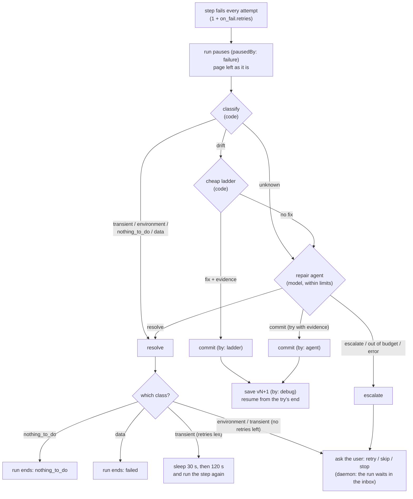

# The repair agent

**Job:** when a step of a saved workflow fails while running, get the run going again **safely**. Only *drift* (the site or app changed) may change the workflow, and only with evidence that the fix works. A verified fix becomes the next version at once, and the run continues from where it stopped. Anything else is resolved without changes, or handed to the user.

The agent is the last of three layers: **classify** (code) → **cheap ladder** (code, no model) → **repair agent** (Nemotron 3 Super with tools on the live page). All three are wrapped by `runWithRecovery`, which turns their outcome into what the run does next.

Code: `packages/player/src/repair/` (`recover.ts`, `classify.ts`, `ladder.ts`, `repair.ts`, `report.ts`, `tools.ts`, `verify.ts`, `env.ts`), rules in `packages/core/src/guard.ts`, wiring in `apps/daemon/src/runner.ts` and `main.ts`. Shared loop, model, briefing and edit operations: [README](README.md).

---

## 1. The whole path, from a failing step to what the run does



---

## 2. When it runs, and when it doesn't

- **Runs:** in the daemon for every run (by hand, schedule, folder trigger) except a **walk-through**. It also runs for `pnpm replay`.
- **Doesn't run:**
  - in a walk-through: a failing step simply fails;
  - without `hooks.recovery`: the run fails.
- **No model configured:** classification and the ladder still run, and the agent step escalates with *"no model configured to repair it (…)"*.
- **What triggers it:** a step that failed every attempt. `runSkill` asks `onFailure`, and `runWithRecovery` always answers `"pause"`.
- **Note:** `on_fail.fallback` ("agent" | "ask") is in the schema and the compile prompt, but **is never read**. Every failure takes this same path.

---

## 3. Classify first (`classify.ts`)

No model. Uses the step's error, the step itself, and, for a web step, the page's signals (`page.op: signals` → `{ url, title, status?, loginLike, dialogs, readyState }`). `loginLike` = a password field, or `log-in | sign-in | auth | sso` in the path.

Rules, **in order** (the first match wins):

| # | Condition | Class | `need` (shown to the user) |
|---|---|---|---|
| 1 | HTTP status ≥ 500 | transient | |
| 2 | status 401/403, or the page looks like a login | environment | log in to `<host>` in the automation window |
| 3 | error `Shadow.app is not running` | environment | start Shadow.app |
| 4 | error mentions accessibility / not trusted / not allowed to control or send | environment | allow Shadow in System Settings > Privacy & Security |
| 5 | extension did not connect / no page target / cannot connect to | environment | open Chrome |
| 6 | `is not installed, or did not start` | environment | the error |
| 7 | operation not permitted / EACCES / EPERM | environment | allow Shadow to use that folder |
| 8 | `net::ERR_`, navigation failed, didn't finish loading, timeout, ECONNRESET/REFUSED, ETIMEDOUT, EAI_AGAIN, socket hang up, CDP connection closed, HTTP 5xx, 429/502/503/504 | transient | |
| 9 | `fs.find` with "no file matches" | nothing_to_do | |
| 10 | an llm step, a `data` step, or "should be / is not a / no row where / not a list" | data | |
| 11 | a web or ax step with "target not found / ambiguous target / covered by / not visible / no menu item / precondition did not hold / like the recorded one / two controls look like the target / has no action to press / did not come forward", or a failed check | drift | |
| 12 | anything else | **unknown** | |

- `transient`, `environment`, `nothing_to_do` and `data` → **resolve** at once: no ladder, no model.
- `drift` → the ladder, then the agent.
- `unknown` → straight to the agent (**the ladder is skipped**).

---

## 4. The cheap ladder (`ladder.ts`)

No model. Each rung builds an edit, checks it with `repairViolations`, then **tries one step** on the live page (`tryDraft`, §9). It's kept only if the try passed **and** showed evidence.

| Rung | When | Edit | Notes |
|---|---|---|---|
| 1. **wait longer** | web: `target not found` and match score 0 (nothing on the page looked like it). ax: "like the recorded one" or "not found" | `set timeout_ms = max(2 × (timeout_ms ?? default), 20 000)` | Web and Mac-app steps |
| 2. **fuzzy match** | web only; the target has a name, label or text; the target isn't built from a variable (`{{…}}`) | `retarget` to the best visible candidate from `find(text, role, limit 5)` | Only if best score ≥ **0.6** and ≥ **0.2** ahead of the second |

A ladder fix is committed with history `"<rung>: <summary>"` (e.g. `fuzzy match: s4: "Submit" is now "Send invoice"`).

---

## 5. Limits (`createRepairer`)

| Limit | Value | What happens past it |
|---|---|---|
| Agent episodes per run | **2** | escalate: *this run already used its 2 repairs* |
| Repair dollars per run | **$0.25** (`left ≤ $0.005` counts as spent) | escalate: *this run already spent its repair budget ($0.25)* |
| Turns per episode | 12 | out_of_budget → escalate |
| Dollars per episode | min($0.10, what's left of the run's $0.25) | out_of_budget → escalate |
| Live actions per episode | 20 | further live tools refused |
| Time | none | |

**"Per run" is really "per leg".** The daemon creates a new repairer (`createRepairer`) every time a run starts or continues after a wait (`apps/daemon/src/main.ts`). After the user answers an inbox item, the run gets fresh episodes and a fresh $0.25. Vision calls aren't counted ([README](README.md) §3.4).

---

## 6. What the agent is given

### 6.1 The failure report (`report.ts`): the task message

Collected before the first turn:

```
# Failure in "<workflow name>" (version N)
Goal: <description.goal>
Never: <…>                                              (if any)

Failed step <id> at <path>: "<intent>"
As run: <the step as JSON, empty fields removed, templates resolved>
Error after <attempts> attempt(s): <error | "check failed">
Best match score for its target: <score>                (when the player reported one)
Cheap signals say: <class> (<reason>)

# The page now                                          (web steps, when a browser is connected)
URL <url> · "<title>" · HTTP <status> · open dialogs: <…>
Controls named like "<target name>": e12 button "Send" (0.82, in dialog "…", under "…"); …   (find, best first)
<untrusted_data>
<page outline, max 120 lines: headings, dialogs, forms, controls with refs>
</untrusted_data>

# The run so far (last events)                          (last 12 log events: step results, branches, loop items, skips)

# Site notes from earlier runs                          (memory: search(<host of the first navigate step, or the workflow name>, this workflow, 5))

# The workflow
<one line per step, indented, the failed step marked →; actions show target JSON, args, [approval]>
```

For a **Mac-app (ax)** failure there's no "page now" section, and the page tools answer "No browser is connected".

### 6.2 The system prompt
`ROLE` (verbatim):

> You are Shadow's repair agent. A saved workflow failed at one step while running on its own, and you get it going again, safely. First decide what kind of failure it is: only drift (the site or app changed: a renamed button, a new banner or dialog, an action moved into a menu, a new confirmation page) may change the workflow. A site that is down, a login page, an empty inbox or bad data is resolved without changing anything.
> To repair drift: look at the page, probe it if you must (open a menu, dismiss a banner), edit the draft, then try_steps to run it on the live page. Commit only when a try shows evidence. Keep the change as small as the page requires, keep step ids, and never change what the user decided. If you can't find a safe fix, escalate and say what the user should show you.

Then `briefing({ edits: true, available })`, which includes **"Available now"** (Chrome extension connected, Shadow.app running, screen consent), then the loop's "How you work".

### 6.3 The environment (`RepairEnv`)

| Field | What it is | Present when |
|---|---|---|
| `runId` | the run | always |
| `deps` | the run's channels, approvals and checks; `try_steps` runs through them | always |
| `page(op)` | page operations in the run's automation tab (§7) | **web failures only** |
| `runLog` | the run's log so far | always |
| `recall(query)` | `memory.search(query, { skillId, limit: 5 })` | memory available |
| `note(fact)` | `memory.add({ kind: "site_note", text, skillId })` | memory available |
| `describeScreen(question)` | masked picture of the page (web) or frontmost window (ax), described | the user allowed **Pictures**, a model is configured, Shadow.app can mask |
| `available` | `{ extension, macApp, screenConsent }` | always (daemon) |

### 6.4 Session (`RepairSession`)
`original` (the failing version: every rule compares against it), `draft`, `failure` (`{ stepId, path, step, result, attempts, vars }`; `path` and `vars` move forward after each try), `env`, `report`, `edits` (every edit applied, in order), `tried` (`{ draft: <steps JSON>, result: TryResult, from }` for the last try).

---

## 7. Tools

Up to 20: 17 always, plus `describe_screen`, `recall` and `note` when available.

### Look
| Tool | Input | Output |
|---|---|---|
| `failure_report` | `{}` | the report again |
| `page_outline` | `{ scope?: ref }` | page outline (headings, dialogs, forms, controls with refs like `e12`); **untrusted** |
| `find` | `{ text, role? }` | controls whose name looks like `text`, best first: `{ ref, role, name, score, visible, near?, dialog? }`; **untrusted** |
| `inspect` | `{ ref }` | one element in detail (`tag, role, name, text, attrs, visible, disabled, near, dialog, selector`) **with the locator a step would store**; **untrusted** |
| `workflow` | `{ step? }` | the draft outline with the failed step marked, or one step as JSON |
| `wait` | `{ ms: 100–10 000 }` | waits on the page (a look: no live action) |
| `describe_screen` | `{ question (1–300) }` | the vision model's description + the masked words on screen; **untrusted** |
| `recall` | `{ query }` | site notes and earlier fixes for this workflow, or "nothing found" |

Without a browser (ax failures), every page tool returns *"No browser is connected: only the workflow and the report can be looked at."* A page error comes back as *"The page answered with an error: …"* (untrusted).

### Probe (live actions)
| Tool | Input | Guard (§8) |
|---|---|---|
| `click_safe` | `{ ref }` | not outward, not a Never word, and a link may not leave the workflow's sites |
| `press` | `{ key: Escape \| Tab \| ArrowDown \| ArrowUp }` | — |
| `scroll` | `{ ref? , direction?: down \| up }` | — |
| `go_back` | `{}` | — |
| `navigate` | `{ url }` | host must be one of the workflow's navigate hosts |

Probes change the live page, not the workflow.

### Edit
| Tool | Input | Notes |
|---|---|---|
| `retarget` | `{ step, ref }` | Takes the locator from `inspect(ref)` and applies `retarget`. Guarded by `repairViolations` |
| `edit` | `{ edits: Edit[] (1–10) }` | Raw edit operations (validated against the `Edit` schema at input time). Guarded by `repairViolations` |

Success: *"Applied. The draft now:\n<outline>"*. A bad edit: *"Not applied: <problems>"*.

### Try
`try_steps` `{ from?: path (default: the failed step), count: 1–5 (default 2) }`: runs the **draft** on the live page (§9). Returns `{ ok, ran: [{path, ok, error?}], error?, next: <path | "(the workflow finished)">, evidence: <reason | "none yet: a step that didn't throw is not evidence; try one more step"> }`. Counts `max(1, steps ran)` live actions. **The page moves on**: the next try starts where this one stopped.

### Finish
| Tool | Input | Result |
|---|---|---|
| `resolve` | `{ class: transient \| environment \| nothing_to_do \| data, reason }` | ends; nothing changes |
| `commit` | `{ summary (1–300) }` | refused unless (§10): the draft has edits; it was tried **as it is now**; the last try passed; and showed evidence. Then also `repairViolations` on the whole draft (guard) |
| `escalate` | `{ reason, what_to_show? }` | ends; the user is asked |

### Remember
`note` `{ fact (1–300) }` → a `site_note` for this workflow, e.g. *"the portal shows a cookie banner first"*.

---

## 8. The guard (`repairGuard`)

Runs before every valid call. Allowed hosts = the hosts of every `navigate` step in the **original** (failing) version.

| Tool | Refused when | Message |
|---|---|---|
| `click_safe` | the element (via `inspect`) looks outward by its name (README §6) | "<name>" looks like it sends, submits, pays, publishes or deletes: probes never do |
| `click_safe` | its name matches a Never entry | "<name>" matches the user's Never rule "<entry>" |
| `click_safe` | it's a link (not `#` / `javascript:`) to another host, **and the workflow has at least one host** | that link leaves for <host> |
| `navigate` | the host isn't in the allowed hosts (**no exemption when there are none**) | <host> is not a site this workflow uses (<hosts> \| none) |
| `retarget` | the retargeted draft breaks `repairViolations` | the violations |
| `edit` | the edited draft breaks `repairViolations` (only checked when the edits apply) | the violations |
| `commit` | the draft breaks `repairViolations` | the violations |

`press`, `scroll`, `go_back`, `wait`, `try_steps` and the look tools are never refused by the guard.

### 8.1 `repairViolations(original, draft)` (`guard.ts`)

| Rule | Message |
|---|---|
| The trigger (when, inputs, defaults) can't change | the trigger (…) is the user's: it can't change |
| The description can't change | the description is the user's: it can't change |
| A removed **llm** step | `<id>`: an llm step is the user's decision: it can't be removed |
| A removed **loop** | `<id>`: a loop can't be removed |
| A removed step that **needs approval** | `<id>`: a step that needs approval can't be removed |
| A removed step with an **ask** | `<id>`: a step with a question for the user can't be removed |
| Approval turned off | `<id>`: approval can't be turned off |
| An ask removed or changed | `<id>`: its question for the user can't be removed or changed |
| An llm step's instruction changed (or the step changed type) | `<id>`: the llm step's instruction is the user's: it can't change |
| A loop replaced, or its `max_items` / `on_item_fail` changed | `<id>`: a loop can't be replaced / max_items and on_item_fail are the user's |
| An action's **args** changed (same channel and action) | `<id>`: its args are the user's values: retarget it or change its wait, not its args |
| An existing step would now act outward (unless it was already outward with the same action, i.e. a retarget) | `<id>`: it would now act outward (…) |
| A script step added, or a step turned into one | `<id>`: repairs can't add scripts |
| A **new** outward step, unless it directly follows an outward step it finishes and needs approval itself (a "Confirm" after "Submit") | `<id>`: a new step can't act outward (…), except to finish an outward step it directly follows, with requires_approval |
| Any step matching a Never entry, unless unchanged from the original | `<id>`: it matches the user's Never rule "<entry>" |
| A `navigate` to a host the original doesn't navigate to (a URL built from a variable is skipped) | `<id>`: <host> is a site this workflow doesn't use |

**What repair *may* do** (no rule against it):
- retarget any action to anything on the page;
- insert new non-outward steps of any channel (click, type, select, wait, navigate to a known host…);
- remove plain action steps;
- change intents, waits, checks, `timeout_ms`, `on_fail`;
- move steps.

That's broader than the design agent in some ways (new clicks) and narrower in others (args are frozen).

---

## 9. Trying a draft (`verify.ts`, `tryDraft`)

1. Copies the draft and **forces `requires_approval: true` on every outward step**.
2. Runs it with the run's own deps from `from` for at most `count` steps (`maxSteps`), with inputs `{}` and the failure's variables.
3. Approvals go to the run's real approve hook. In the daemon that **always answers `WAIT`** (nobody can answer during a repair). Only a real `true` counts as approved.
4. Results:

| Run outcome | `TryResult` |
|---|---|
| waiting (an approval or ask nobody can answer now) | `ok: false`, `error: "<step>: needs the user's approval / an answer … and nobody can give it now"`; no resume (the page hasn't moved) |
| failed / denied | `ok: false`, `error: "<step>: <error>"`; resume at the failed step if more than one step ran |
| succeeded (reached the end) | `ok: true`; evidence = "the workflow ran to the end and its success checks pass" if it has `success` checks, else the last step's own evidence |
| paused after `count` steps | `ok: true`, `resume`; evidence from the last step, else from the next step |

**What counts as evidence:**
- the last step ran OK **and** has a `check` → "<path>'s check passed";
- the last step's action is self-verifying (`type, select, upload, extract, navigate, set_value`) → "<path> (<action>) is verified by the player";
- otherwise, for a next **web** step: its `wait` holds within 5 s, or its target is visible within 5 s;
- otherwise **none**. "A click that didn't throw is not evidence."

**Consequence in the daemon:** a try that reaches an outward step stops as *waiting*, so the agent **can't prove a fix to, or past, an outward step** (Submit, Send). Fixing the step *before* one is fine (the next step's target being visible is evidence).

---

## 10. Committing

`commitProblem` (in the `commit` tool):
1. no edits → *the draft has no changes: if nothing needs changing, resolve instead*
2. no try, or the draft changed since the last try → *the current draft hasn't been tried: call try_steps first*
3. the last try failed → *the last try failed (<error>)*
4. the last try had no evidence → *the last try showed no evidence that the fix works: try one more step*

Then the guard checks `repairViolations` on the whole draft.

**Not required:** that the try **started at or before the failed step**. `try_steps` takes any `from`, so a fix can be committed on evidence from later steps (open item, `docs/guide/14-shadow-end-to-end.md` §7 item 2).

On commit (`repair.ts`):
- the new version = the draft with `version + 1` and history `{ by: "debug", summary }` (the ladder writes `"<rung>: <summary>"`);
- `resume` = where the last try stopped (none = the workflow finished: the run ends `succeeded`);
- `approveOnce` = every outward step whose target changed (or is new) and that the try didn't run with a real approval. These get `requires_approval` the first time they run, kept across waits in the run's resume.

---

## 11. What the run does with the outcome (`runWithRecovery`)

| Outcome | Run |
|---|---|
| commit | `saveVersion` (daemon: `skills/<id>/v<N>.json`, at once, no review), log `repair` event with `by` and `version`; continue from `resume`, or end `succeeded` |
| resolve `nothing_to_do` | ends `nothing_to_do` |
| resolve `data` | ends `failed` |
| resolve `transient`, retries left | sleeps **30 s**, then **120 s** (`retryAfterMs`), and runs the step again (the same version) |
| resolve `environment`, or `transient` with no retries left | asks the user: *"<path> needs you: <need>."* or *"<path> failed: <error>."* |
| escalate (incl. out of budget, error, no model, limits used) | asks the user: *"couldn't repair <path>: <reason>. Do it by hand: <what_to_show>."* |

"Asks the user" = `waitForUser`. In the daemon it answers `WAIT`: the run ends `waiting` with an inbox item `recovery` (options **retry / skip / stop**), and its checkpoint is saved. Later:
- **retry** runs the stuck step again (a new leg, a new repairer);
- **skip** goes on after it ("I did it by hand");
- **stop** ends the run `failed`. A cancel from the inbox ends it `cancelled`.

---

## 12. Memory

| | |
|---|---|
| Reads | The failure report includes `search(<host of the first navigate step, or the workflow name>, this workflow, 5)` as "Site notes from earlier runs". `recall(query)` → `search(query, this workflow, 5)` |
| Writes | `note(fact)` → `site_note` for this workflow, only when the agent calls it |
| Not written | The fix itself (it's in the version history, not memory); what a resolve or escalate learned; the ladder's fixes |

Notes are per workflow: a note about a site isn't shared with another workflow on the same site.

---

## 13. Pictures

`describe_screen` exists only with the Pictures consent. Web: the extension takes a screenshot of the automation tab (`page.op: screenshot`). Mac app: Shadow.app saves the frontmost window (`mac.screenshot`) to a temporary file. Either way the daemon:
1. reads the words (Apple Vision);
2. masks them, with the workflow's **Never** words added;
3. blacks them out;
4. sends one picture to GLM-5.3-Flash with the agent's question;
5. returns `<description>\n\nWords on screen (private ones masked):\n<words>`;
6. deletes the picture.

The replay window may be blank: in the YC run it described *"a solid dark/black image"*.

---

## 14. What is kept

| Where | What |
|---|---|
| `runs/<runId>.jsonl` | `step.start` / `step.result` per attempt; `run.end` (`paused`, `failedStep`, error); then a `repair` event `{ path, outcome, class, summary, costUsd, by?, version? }` |
| `runs/<runId>.repair-<n>.json` | `{ failure: <path>, outcome, transcript: AgentEvent[] }` per **agent** episode. Numbered across a run's legs. The ladder has no file (its fix is in the `repair` event and the version history) |
| `skills/<id>/v<N+1>.json` | the committed version, history `by: debug` |
| inbox (`shadow.db`) | the `recovery` item and the user's answer |

**Not kept:** the failure report's full text beyond what `failure_report` returned in the transcript, the system prompt, the model's reasoning, the inputs of invalid calls.

---

## 15. Tests (`packages/player/src/repair/*.test.ts`)

With a scripted model, against fixture pages (`fixtures/pages/drift`: renamed, reworded, banner, menu, confirmation, logged out):
- resolves a login page as environment, without a model and without changing the workflow
- resolves an empty folder as nothing to do
- retargets a reworded button with one clear match (ladder), verified by its check; the run resumes on the new version
- finds a renamed button the ladder can't, retargets it, tries it, and commits
- dismisses a new cookie banner by adding a step before the blocked one
- finishes a new confirmation step with approval, and is refused a probe that would confirm
- opens a menu to reach a moved action; won't commit without changes or before a try works
- escalates when it can't find a safe fix, or runs out of budget, and keeps to the run's limits
- is refused an edit that breaks the user's decisions
- `verify.test.ts`: a try that waited for approval is not ok, approves nothing, runs nothing; a commit on such a try is refused
- `recover.test.ts`: ends as waiting when nobody can answer, goes on after the step the user did by hand; keeps a retargeted outward step's first-time approval across a wait
- `describe.test.ts`: the masked picture as untrusted data; no tool without consent
- `agent.test.ts` (loop): refuses the edit the page asked for (prompt injection), applies the right one, commits

**Not tested:** a real model; a workflow with no navigate step; a Mac-app repair beyond the first rung; repair after a wait (budget reset); an `unknown` failure.

---

## 16. Known weaknesses: where to improve

### Rules that block good repairs
1. **Allowed sites come only from navigate steps** of the failing version (§8). A workflow without one (e.g. after a bad design) can't open its own site: *"www.ycombinator.com is not a site this workflow uses (none)"*. Use every version's navigate hosts, the recording's visited URLs, and the hosts in steps' `check.url_matches`.
2. **No fix for "the run started on a blank page"**: the workflow never opens a page. Let repair insert a first `navigate` when the target site is known, or catch it at save time (`check.ts`).
3. **Outward steps can't be proven** (§9): the daemon's approve hook is always `WAIT` during a try. Ask the user once ("Shadow wants to try the fixed Submit: allow?") or accept the next page's evidence for an outward step.
4. **Args are frozen.** A changed field format (e.g. a date input that now needs `2026-10-14` instead of `14 Oct`) can't be fixed by repair; it escalates.

### Rules that let weak repairs through
5. **A try may start after the failed step** (§10), so a commit can lack proof the failed step works.
6. **Repair may add new non-outward clicks** on any control. Combined with the outward word list being the only safety net, a click on an unlabelled icon that does something irreversible isn't caught.
7. **Commits are saved immediately** with no user review; rollback is the only undo.

### Limits
8. **Per-run limits reset after every wait** (§5). Keep the repairer's spend and episode count in the run's checkpoint.
9. **`unknown` failures skip the ladder** (§3). Try rung 1 (wait longer) for unknown web failures too.
10. **Mac-app repair is thin**: only the first rung, no page tools. The agent can only look at the workflow, describe the screen (with consent) and edit blind.
11. **`on_fail.fallback` is never read** (§2): the schema promises per-step control that doesn't exist.
12. **`on_item_fail: "skip"` never skips while recovery is on**: a failing item goes through repair and then the user (`docs/guide/14-shadow-end-to-end.md` §7 item 4).

### What the agent sees
13. The failure report is built once. After probes and tries, the agent must re-read the page itself; the report's "page now" goes stale.
14. Site notes are per workflow, not per site (§12).
15. Keep reasoning, the system prompt and refused inputs in the episode file (README §10); meter vision calls (README §3.4).
