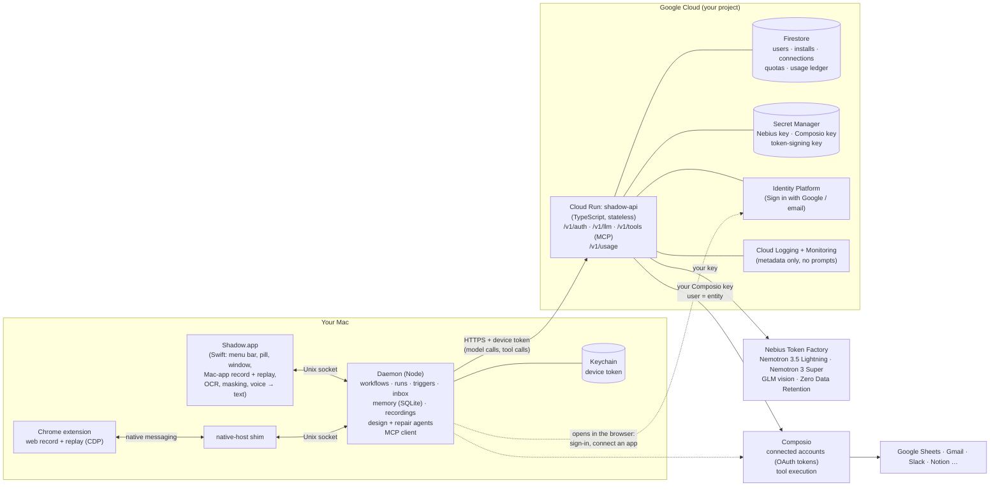
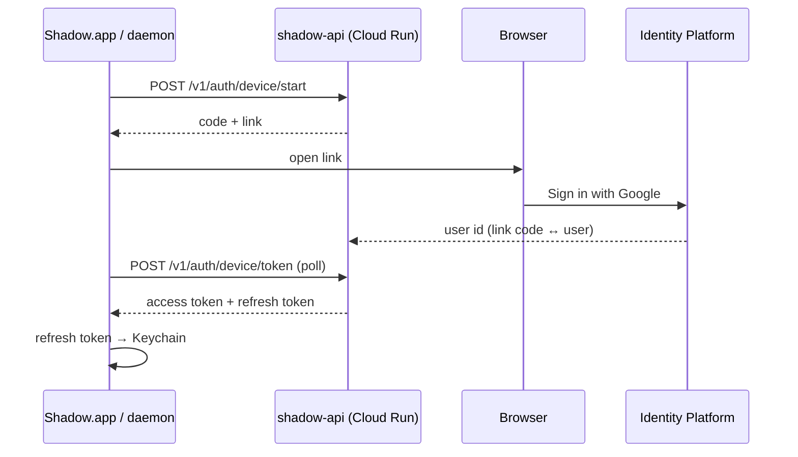

# Shadow, managed: the cloud architecture

**Decided Oct 25, 2026: Shadow becomes a managed service.** Users no longer bring a Nebius Token Factory key. Shadow's own cloud service holds the model key, connects the apps a user links (Google Sheets, Gmail, Slack…) through **Composio**, and keeps user accounts, quotas and usage.

Everything that is about *your* work stays on your Mac, as today:
- recording, screenshots, narration, masking;
- the workflows, runs, memory and the inbox;
- replay in your Chrome and your Mac apps;
- the agents' loop.

What changes is **where model calls and app connections go**: to `api.shadow…` (Google Cloud), not straight to Nebius.

This document is the target. Where it differs from [`design.md`](design.md) ("Architecture", "Models", "Privacy"), this wins once built.

---

## 1. The picture

**Three places run code:** your Mac (what exists today), **one Cloud Run service** (new), and two external services (Nebius for models, Composio for app connections).

---

## 2. Components: what runs where

### On the Mac (unchanged apart from four things)

| Component | Runs | Does | Changes |
|---|---|---|---|
| **Shadow.app** | your Mac (Swift) | menu bar, Record pill, window, Mac-app record/replay, OCR, masking, voice → text, first run | first run: **Sign in** instead of "paste your key"; Settings: **Connected apps** |
| **Daemon** | your Mac (Node, inside the app) | workflows, versions, runs, triggers, inbox, memory, recordings, **the design and repair agents** | model client points at `shadow-api` with the device token; new **MCP client** and an `mcp` step; key UI removed (a developer `.env` override stays) |
| **Chrome extension** | your Chrome | web record/replay | none |
| **native-host shim** | your Mac | Chrome ↔ daemon bridge | none |
| **Keychain** | your Mac | today: the Nebius key | holds the **device token** (refresh token) instead |

**Why the agents stay on the Mac.** They read the recording folder (screenshots, narration) and drive the live page through your Chrome (test runs, repair). Moving them to the cloud would mean uploading recordings and tunnelling the browser. Only their *model calls* and *tool calls* go out, as before; they now go through `shadow-api`.

### In Google Cloud (new)

| Component | GCP product | Does | Notes |
|---|---|---|---|
| **shadow-api** | **Cloud Run** (one service, TypeScript, same monorepo: `apps/api`) | the only door: auth, model relay, tool relay, usage | stateless; scales to zero; min instances 1 during the demo (no cold start) |
| **User accounts** | **Identity Platform** (Firebase Auth) | Sign in with Google or email, in the browser | gives a user id; Shadow keeps nothing else about the person |
| **Data** | **Firestore** (Native mode) | users, installs (devices), connected apps, quotas, usage ledger | small documents; free tier covers the hackathon |
| **Secrets** | **Secret Manager** | Nebius key, Composio key, the key that signs device tokens | read by Cloud Run at start; never in the app or the repo |
| **Logs, metrics, alerts** | **Cloud Logging / Monitoring / Error Reporting** | request metadata, latency, errors, spend alerts | **prompts and tool arguments are never logged**: only sizes, model, tokens, cost, status |
| **Abuse protection** | **Cloud Armor** (optional) + per-user quotas in code | rate limits by IP and by user | quotas are the real guard (§5) |
| **Builds** | **Artifact Registry + Cloud Build** | container image of `apps/api` | deploy with `gcloud run deploy` (or GitHub Actions) |

### External

| Service | Does | Holds |
|---|---|---|
| **Nebius Token Factory** | every model call: Nemotron 3.5 Lightning (`fast`), Nemotron 3 Super (`smart`), GLM vision | your key; **Zero Data Retention on your organisation** (prompts not stored or trained on) |
| **Composio** | the user's connected apps: the OAuth sign-in, token storage and refresh, executing a tool (`GOOGLESHEETS_…`) | the user's app tokens (managed auth apps for now) |
| **Google, Slack, Notion… APIs** | the actual work | — |

---

## 3. `shadow-api`: the routes

All routes need `Authorization: Bearer <device access token>`, except sign-in.

| Route | What | Talks to |
|---|---|---|
| `POST /v1/auth/device/start` | the app asks to sign in: returns a short code and a browser link | Firestore |
| `GET /signin?code=…` (web) | you sign in with Google/email (Identity Platform); the code is linked to your user | Identity Platform, Firestore |
| `POST /v1/auth/device/token` | the app polls until you've signed in, then gets an **access token** (15 min) and a **refresh token** (Keychain) | Firestore, Secret Manager |
| `POST /v1/llm/chat/completions` | **OpenAI-compatible**, streaming; the daemon's model client uses it unchanged (base URL + token). Checks quota, maps profile → model, adds your key, meters tokens and cost | Nebius |
| `GET /v1/tools/mcp` (Streamable HTTP) | **one MCP server per user**: lists the tools of the apps *this user* connected, executes them as the user's Composio entity. The daemon's MCP client connects here | Composio |
| `POST /v1/tools/connect` | starts connecting an app (e.g. Google Sheets): returns Composio's sign-in link, opened in your browser | Composio |
| `GET /v1/tools/connections` · `DELETE …/:id` | what you've connected; disconnect | Composio, Firestore |
| `GET /v1/usage` | today's and this month's use against your quota | Firestore |

**Why one MCP endpoint per user.** The daemon stays a plain MCP client (it could also talk to local MCP servers later). The backend hides Composio: tools are filtered to what *this* user connected, and Composio's key never leaves the server. Swapping Composio for another catalog later changes only `shadow-api`.

---

## 4. The flows

### First run (sign-in, no key)

### Connecting an app
Settings → Connected apps → **Google Sheets** → `POST /v1/tools/connect` → Composio's sign-in page in your browser → you allow access → Composio keeps the tokens → the daemon's MCP tool list now has the Sheets tools.

### Recording → workflow
The recording, screenshots, narration and masking all happen **on the Mac**, as today. The design agent runs in the daemon:
- its model calls go to `/v1/llm` (masked text only, as today);
- it also sees the MCP tools you've connected, and may propose an **`mcp` step** (e.g. `GOOGLESHEETS_APPEND_ROW`) in place of the clicks into the sheet;
- you confirm it in the review.

### A run
Steps run in order on the Mac:
- **web and Mac-app steps:** locally, as today;
- **`mcp` steps:** the daemon → `/v1/tools/mcp` → Composio → the app's API;
- **AI steps:** `/v1/llm`.

**Approvals:** an MCP tool whose annotation says it changes things (`destructiveHint`, or not `readOnlyHint`) waits for your OK, like Send.

---

## 5. Security, privacy, money

**What leaves the Mac now:**
- **To `shadow-api`, then Nebius** (as before, only the route changes): masked screen words, narration text, workflow steps, the AI step's input data.
- **New, to Composio:** tool arguments and results (the row you append, the email you read).
- **Never:** screenshots, unless the user allows Pictures (then one masked picture per request, as today); audio; your recordings; your workflows.

**Rules in `shadow-api`:**
- **Device tokens:** short-lived access token plus a refresh token in the Keychain, revocable per device.
- **Quotas:** per user and per day, in dollars and tool calls, enforced *before* the call. Hard monthly cap per user; alert at 80% of the project budget (Cloud Billing alert).
- **Request size limits;** model allow-list (only the three profiles); no free-form model choice from the client.
- **No prompt logging.**
- **ZDR on in the Nebius organisation.**

**Cost at hackathon scale:**
- Cloud Run, Firestore, Identity Platform and Secret Manager are essentially in their free tiers.
- Models: about $0.09 to design a recording; under $0.01 per AI step; about $0.05 per repair.
- Composio Hobby: 100k tool calls a month (20k through its own OAuth apps).

**The privacy section changes** (`readme.md`, `docs/product.md`, the first-run screen). "No server of ours" becomes: "Your recordings and workflows stay on your Mac. Model calls and connected-app calls go through Shadow's server (no prompts stored), Nebius (Zero Data Retention) and Composio (holds your app connections)."

---

## 6. What changes in the code

| Where | Change |
|---|---|
| **new `apps/api`** | the Cloud Run service (§3): Hono or Fastify, Firestore client, Composio SDK, an OpenAI-compatible relay; Dockerfile |
| `packages/llm` | `configFromEnv` / Keychain path → **`configFromAccount`**: base URL `https://api…/v1/llm`, token from the daemon's auth; `.env` keeps working for development |
| `apps/daemon` | auth (device flow, token refresh, Keychain); **MCP client** (`@modelcontextprotocol/sdk`, Streamable HTTP to `/v1/tools/mcp`); Settings API: account, connected apps, usage; key routes removed |
| `packages/core` | a new step: `{ type: "action", channel: "mcp", action: "<tool>", args }`; approval from the tool's annotations; the capability briefing lists connected tools |
| `packages/player` | runs `mcp` steps through the daemon; repair: an MCP step's failure is classed (auth expired → environment; 5xx → transient; bad args → data) |
| `packages/recorder` (design agent) | connected tools offered as options; propose an `mcp` step for a recorded UI sequence that a tool does (sheet writes first). **With Rushil: record-v3 owns this** |
| `apps/mac` + `apps/ui` | first run: Sign in; Settings: Connected apps, Usage; the key screen goes |

---

## 7. Why Google Cloud, and Nebius as an option

Cloud Run gives a TLS endpoint from a container in one command, scales to zero, and pairs with Identity Platform, Firestore and Secret Manager with no servers to run. That's the shortest path to a working managed service.

**Nebius can host it too.** Nebius AI Cloud offers general compute (virtual machines, managed Kubernetes) beside Token Factory. The same container would run there. For a Nebius x NVIDIA hackathon that may be worth it after the first deploy works: the container doesn't change; only the identity, database and secrets services would need Nebius or self-run equivalents.

**Region:** put Cloud Run near the Token Factory endpoint you use, since every model call makes that hop (check which region your key's endpoint is in).

---

## 8. Order of work (to Oct 30)

| # | What | Size |
|---|---|---|
| 1 | GCP project, Secret Manager (Nebius + Composio keys), Firestore, Identity Platform; `apps/api` with `/v1/llm` relay + device sign-in; deploy to Cloud Run | 1 day |
| 2 | Daemon: sign-in + token refresh; model client → `/v1/llm`; first-run screen | ½ day |
| 3 | Composio: Google Sheets toolkit; `/v1/tools/connect` + `/v1/tools/mcp`; daemon MCP client; Settings → Connected apps | 1 day |
| 4 | `mcp` step in core + player, approvals from annotations; design agent proposes it for sheet writes (with Rushil) | 1 day |
| 5 | Quotas, privacy text, re-record the KPI → sheet task, demo | ½ day |

**Cut first if needed:** usage screen, Cloud Armor, Gmail (Sheets alone shows the idea).

---

## 9. Open questions

- **Hackathon rules:** if judges must use their own Token Factory key, keep a developer override (the `.env` path exists) and document it for judging.
- **Composio's managed Google app vs your own:** managed is instant but counts toward the 20k-call limit and shows Composio on the consent screen; your own needs Google's review for Gmail. Managed for now.
- **Billing:** Stripe later; a free tier with caps for now.
- **Offline:** without the network nothing that needs a model or a connected app runs; web and Mac-app steps still do. Fine, but say so in the app.
