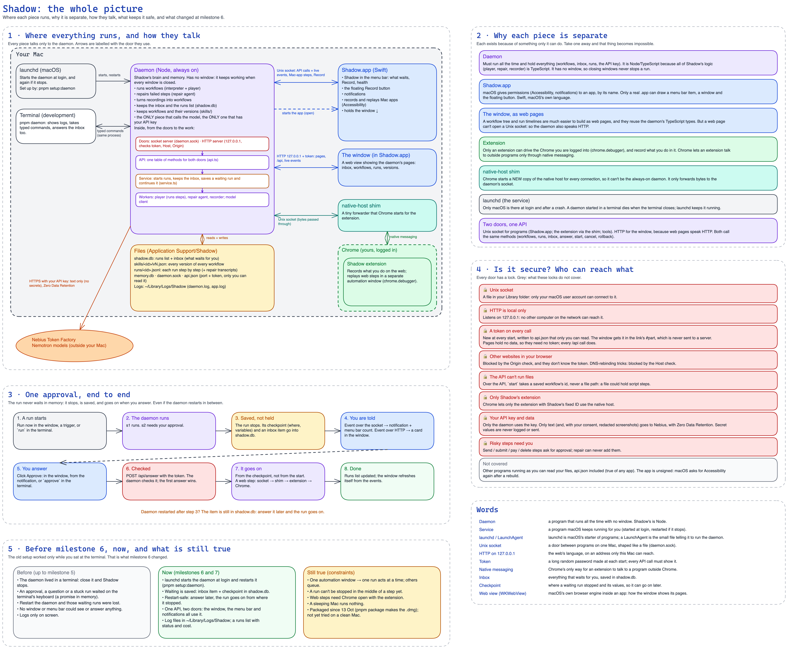

# Shadow: the whole picture

> **Superseded on 25 Oct 2026** by [the managed version](../13-the-whole-picture.md); kept for its how-to-read notes on the local pieces.
>
> Written 12 Oct 2026, after milestones 6 and 7 (the daemon as a service, the inbox and API, the window, the menu bar).
> The design itself is [`docs/design.md`](../../design.md); this page is a map of it.
>
> **Since 13 Oct:** no screenshot from a recording goes to Nebius, only the words read from it on the Mac, with private ones masked (design.md, "Redaction"). Whether the repair agent may send a redacted picture is an open question; it doesn't today. The diagram's box "Is it secure?" predates this.
>
> **Since 13 Oct, evening:** decided and built. A masked picture goes to the model only with a separate **Pictures** consent, when the design agent or the repair agent asks to see the screen (design.md, "Consent"). The app is packaged (`pnpm package` makes a `.dmg` with the daemon, Node and the extension inside; the key goes to the Keychain on first run), and the window has the editor, Walk through and Settings. The diagram's note "runs from the repo for now" was updated; the rest holds.

Edit it: open [`13-the-whole-picture-oct12.excalidraw`](13-the-whole-picture-oct12.excalidraw) at [excalidraw.com](https://excalidraw.com) (menu → Open) or in the VS Code Excalidraw extension.

## How to read it

1. **Where everything runs, and how they talk.** Every piece talks only to the daemon, and every arrow says which door it uses: the Unix socket (programs), local HTTP with a token (the window), native messaging (Chrome to the shim). Inside the daemon, a request goes from a door to the API, to the service, to the workers.
2. **Why each piece is separate.** Each box is there because of one thing only it can do: macOS gives permissions to an *app*; only an *extension* can drive your logged-in Chrome; Chrome starts a fresh *native host* per connection; only *launchd* is there at login; a *web page* can't open a Unix socket, so the daemon also speaks HTTP.
3. **One approval, end to end.** The run never waits in memory: it stops, its checkpoint and an inbox item are saved, you are told (notification, menu bar, window), you answer, and it goes on from where it stopped, also after a restart.
4. **Is it secure?** One lock per door, and what the locks don't cover.
5. **Before milestone 6, now, and what is still true.** What the old terminal-only setup could not do, what changed, and the constraints that remain (one acting run at a time, no stop mid-step, Chrome must be open, a sleeping Mac runs nothing, the packaged app not yet tried on a clean Mac).

**Words** at the bottom right: daemon, service, launchd, socket, token, native messaging, inbox, checkpoint, web view.
