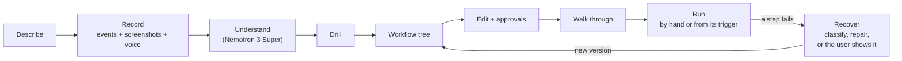

<p align="center">
  
</p>

<h1 align="center">Shadow</h1>

<p align="center">
  <b>Do a work task once. Shadow learns it, runs it for you, and repairs it when a site changes.</b>
</p>

<p align="center">
  <a href="LICENSE"></a>
  <a href="#nvidia-nemotron-on-nebius-token-factory"></a>
  <a href="#nvidia-nemotron-on-nebius-token-factory"></a>
  
  
  
</p>

<p align="center">
  <a href="#quick-start">Quick start</a> ·
  <a href="#nvidia-nemotron-on-nebius-token-factory">Nemotron on Token Factory</a> ·
  <a href="#feedback-token-factory-ai-cloud-and-nemotron">Feedback</a> ·
  <a href="#how-it-works">How it works</a> ·
  <a href="#running-from-the-repository">Full setup</a> ·
  <a href="docs/product.md">User guide</a>
</p>

---

You show Shadow a task the way you normally do it, and you can say what it is for. It works out the steps and asks about anything it is unsure of. From then on it runs the task by itself: on a schedule, when a file arrives, or when you start it.

Anything only you should decide waits in an inbox (send this? which file?). When a page changes, Shadow repairs the workflow instead of stopping. It runs on your Mac, is always on, and keeps its memory and your data there.

| 1 · You do it once | 2 · It runs on its own | 3 · It repairs itself |
| --- | --- | --- |
| Shadow records the task in Chrome, Mac apps and Finder. **NVIDIA Nemotron 3 Super** turns the recording into a workflow of about 10 named blocks, with loops, branches and connected-app steps, and asks only what is unclear. | The workflow runs on a schedule, when a file appears, or when you start it. Clicks and typing replay with **no model call**. An AI step (summarise, classify, pick) uses **Nemotron 3.5 Lightning**. Steps that send, submit, pay or delete wait for your OK. | When a page has changed, cheap fixes come first. Then the **repair agent** (Nemotron 3 Super) fixes the workflow and tries the fix on the live page. A fix that works is saved as the next version, and you can roll it back in one click. |

Built for the Personal AI track of the [Nebius x NVIDIA Global AI Hackathon](https://nebiusglobalaihackathon.devpost.com/). Shadow is an always-on, private assistant with persistent memory and reusable skills. Its models are **NVIDIA Nemotron** on **Nebius Token Factory**. It is open source under the [MIT License](LICENSE).

## Contents

- [Quick start](#quick-start): three ways in, from free and offline to the whole product
- [NVIDIA Nemotron on Nebius Token Factory](#nvidia-nemotron-on-nebius-token-factory): which model does what, and where Token Factory sped up our work
- [Feedback: Token Factory, AI Cloud and Nemotron](#feedback-token-factory-ai-cloud-and-nemotron)
- [What works today](#what-works-today) · [How it works](#how-it-works) · [Privacy](#privacy)
- [Running from the repository](#running-from-the-repository): full setup, running it, and [troubleshooting](#troubleshooting)
- [Reference](#reference): terminal commands, the daemon's API, development, repository guide
- [Success metric](#success-metric-task-coverage) · [Install, deploy, release](#install-the-packaged-app) · [License](#license)

## Quick start

**You need:**
- macOS 14 or later, Node 22 or later, and Google Chrome.
- pnpm 10. Node ships it: run `corepack enable pnpm` once.
- The Xcode command line tools, only for Shadow.app (`xcode-select --install`).
- A Nebius Token Factory API key, for anything that calls a model. Get one at [tokenfactory.nebius.com](https://tokenfactory.nebius.com): your project → API keys.

```sh
git clone https://github.com/Akshat-Soni02/nxn-global-ai-hackathon-personal-agent.git
cd nxn-global-ai-hackathon-personal-agent
corepack enable pnpm
pnpm install
```

### A · Free and offline: no key, about 2 minutes

```sh
pnpm test                                         # about 1,000 tests; no network and no model (a scripted fake model)
pnpm design:eval fixtures/recordings/yc-top-job   # one real recording turned into a workflow by code alone (fake model)
```

The second command shows each stage of [the pipeline](#how-it-works) on a real recording:
- the 11 recorded events become 5 steps;
- the evidence package is built;
- the workflow is saved in a scratch folder;
- the checks from the recording's `expect.json` print as ✓ or ✗.

Nothing in the repository changes.

### B · With your key: watch Nemotron design a workflow (cents)

```sh
cp .env.example .env                                         # put your Token Factory key in NEBIUS_API_KEY
pnpm llm:check                                               # one small call per model: answers, json_schema, tool calls, images (< $0.01)
pnpm design:eval fixtures/recordings/yc-top-job --real       # says what it may spend, and stops
pnpm design:eval fixtures/recordings/yc-top-job --real --yes # Nemotron 3 Super designs it (at most $0.25)
```

**What the run does.** Nemotron 3 Super reads the recording, writes what the task is, plans the workflow, then writes, tests and corrects it with tools. A critic reviews it before it is saved.

**Recordings to try.** `fixtures/recordings/` has four: `yc-top-job`, `kpi-email-to-sheet`, `timesheet` and `playstore-to-chat`. In our runs a design cost between $0.01 and $0.20. Add `--model <id>` to try another Token Factory model.

**The spending cap.** Each real run adds a row to [`testing/design-eval-ledger.md`](testing/design-eval-ledger.md). The script refuses to run once that file adds up to $10; it already holds about $7 of our own runs.

### C · The whole product: record, run, repair

```sh
pnpm build                  # the extension, the native host, the window and the website
pnpm setup:mac              # builds Shadow.app: menu bar, Record button, Mac-app recording
pnpm setup:native-host      # lets Chrome talk to the daemon
```

Then add the extension to Chrome:
1. Open `chrome://extensions` and turn on **Developer mode**.
2. Press **Load unpacked** and pick `apps/extension/dist`.
3. In the extension's **Details**, turn on **Allow access to file URLs**.

Then start Shadow:

```sh
pnpm daemon                 # Shadow starts; open the window from the menu bar
```

Press **Record**, do a task in Chrome, then press **Stop**. Answer Shadow's questions, then press **Run now** on the workflow's page.

To write to Google Sheets, Gmail and other apps, also run `pnpm api` (it needs `COMPOSIO_API_KEY`). Every step is in [Running from the repository](#running-from-the-repository), and [`docs/product.md`](docs/product.md) shows the window screen by screen.

## NVIDIA Nemotron on Nebius Token Factory

Every model call goes through one package, [`packages/llm`](packages/llm/src), to Token Factory's OpenAI-compatible API. A caller picks a **profile**, not a model. Each profile's model is one line in [`catalog.ts`](packages/llm/src/catalog.ts), or one variable in `.env` (`SHADOW_MODEL_FAST`, `SHADOW_MODEL_SMART`, `SHADOW_MODEL_VISION`).

| Profile | Model on Token Factory | What it does in Shadow | Code | Price per 1M tokens (in · out) |
| --- | --- | --- | --- | --- |
| `fast` | **NVIDIA Nemotron 3.5 Lightning**<br>`nvidia/Nemotron-3_5-Lightning`<br>30B MoE, 3B active, 1M context | The **AI steps inside a workflow**, on every run: summarise an email, classify a ticket, pick "the jobs not already in the sheet". Thinking is off, and the answer is checked against the step's type. Also the model check in Settings. | [`player/src/node/llm-step.ts`](packages/player/src/node/llm-step.ts) | $0.06 · $0.24 |
| `smart` | **NVIDIA Nemotron 3 Super**<br>`nvidia/nemotron-3-super-120b-a12b`<br>120B MoE, 12B active, 256K context | The **design agent**: it reads a recording, writes the task model, plans, then writes and tests the workflow with tools, and a critic reviews it. **"What would you like to change?"**: it edits a saved workflow from one sentence. The **repair agent**: it fixes a workflow when a page has changed, or offers a connected app's step instead. A **second try** when an AI step gives an answer code knows is wrong. | [`recorder/src/design/v2/`](packages/recorder/src/design/v2), [`player/src/repair/`](packages/player/src/repair) | $0.30 · $0.90 |
| `vision` | GLM-5.3-Flash (not NVIDIA)<br>`zai-org/GLM-5.3-Flash` | Only with the **Pictures** consent: when an agent asks to see the screen, one picture is described, with its private lines blacked out. It is the cheapest vision model on Token Factory. | [`llm/src/vision.ts`](packages/llm/src/vision.ts) | $0.15 · $0.50 |

### How Nemotron is used

- **The design agent is an agent, not a single prompt.** Nemotron 3 Super runs in a tool loop ([`packages/agent`](packages/agent/src)). Its tools are `write_workflow`, `edit_workflow`, `read_workflow`, `look`, `ask`, `test` and `done`. Code checks every draft ([`gate.ts`](packages/recorder/src/design/v2/gate.ts)), and those checks catch, for example:
  - a step the runner can't run;
  - work from the recording that was left out;
  - a schedule on days or at a time you never said;
  - more AI calls than a run allows.

  A second Nemotron call, the critic ([`critic.ts`](packages/recorder/src/design/v2/critic.ts)), reads the whole result before it is saved.
- **Replay is deterministic.** Clicks, typing, file moves and app calls make no model call. Nemotron is called only for an AI step (Lightning, about $0.0002 a step) or when a step fails (Super). So a workflow that runs every morning costs almost nothing.
- **A small model first, then a bigger one.** If Lightning's answer fails code's check, the same question goes once to Super, along with what was wrong. On 24 Oct, Lightning picked an already-saved story again after being told not to; Super was right 3 times out of 3.
- **Repair keeps only what it proves.** The repair agent gets the failing step, an outline of the page and what changed. It proposes a fix, the fix is tried on the live page, and it is saved as a new version only when it works. It can never add a step that sends or pays, or turn an approval off ([`guard.ts`](packages/core/src/guard.ts)).

### Where Token Factory sped up our work

- **One key and one client for three models from two families.** Swapping a model is a config change, and `pnpm llm:check` confirms what the new one supports before we rely on it.
- **Structured output with `json_schema`.** Every agent action and every AI step's answer is JSON checked against a schema, so we wrote no parsing code. A reply that fails the check is retried once with the errors.
- **Thinking switched on or off per call** (`chat_template_kwargs.enable_thinking`). Lightning answers without reasoning, fast and cheap. Super reasons when it designs or repairs.
- **Prices that allow a model call on every run.** At $0.06 per 1M input tokens, Lightning lets a scheduled workflow carry AI steps every day. A whole design of a recording on Super cost between $0.01 and $0.20.
- **Prompt caching without asking for it.** The design prompt, sent a second time, came back with 2,784 of its 2,806 input tokens cached (measured 28 Oct).
- **Zero Data Retention** is an organisation setting, which a private assistant needs: prompts are neither stored nor used for training.
- **Fast, cheap iteration on real runs.** About 100 real design and repair runs between 20 and 28 Oct cost about $8 in all. Every one is logged in [`testing/design-eval-ledger.md`](testing/design-eval-ledger.md).

### Other Nebius tools and services

**Token Factory is the only Nebius service Shadow uses.** It does not use Nebius AI Cloud.

Shadow's one small server is `shadow-api` ([`apps/api`](apps/api)). It handles sign-in, relays model calls with the Token Factory key added, and connects apps through Composio. It is a stateless container built for Google Cloud Run, and it runs locally with `pnpm api`. [The same container could run on Nebius AI Cloud's compute](docs/cloud-architecture.md#7-why-google-cloud-and-nebius-as-an-option).

## Feedback: Token Factory, AI Cloud and Nemotron

What we found while building Shadow. Each point comes from a run or a measurement in this repository.

### Nebius Token Factory

**What worked well**
- The OpenAI-compatible API, `json_schema` output, tool calling and the thinking switch all worked the same way across both Nemotron models. Adding a model was a catalog row.
- Prompt caching happens by itself and saves most of an agent's repeated input (2,784 of 2,806 tokens on a repeated design prompt).
- Zero Data Retention as one organisation-wide setting made the privacy story simple to explain and to check.

**What was hard**
- **Reasoning and the answer share one `max_tokens` budget.** With thinking on, Nemotron 3 Super once spent the whole 8,192-token budget on reasoning while writing a workflow, and returned no answer (25 Oct). We doubled the budget to 16,384. A separate reasoning budget, or a clear error when reasoning uses up `max_tokens`, would make this easy to spot.
- **Cached tokens have no published price.** Usage reports `cached_tokens`, but we can't price them. Shadow's meter therefore charges every input token in full, so the costs we show are an upper bound.
- **Reliable structured output needed the schema twice**, in `response_format` and in the prompt, as Nebius's docs recommend. We also kept fallbacks: `json_schema`, then `json_object`, then text.
- **The catalog changes often.** Models were removed in waves in June and August 2026. We keep model ids in config so a swap is one line. Deprecation dates in `/v1/models` would help builders plan.
- **Onboarding needs a bank card** before the $1 trial credit. That was fine for us, but it is a hurdle for students.

### NVIDIA Nemotron

**What worked well**
- Nemotron 3 Super with tools reads a messy recording and builds a workflow with loops, branches, AI steps and connected-app steps. On a real YC → Google Sheets recording, its 7th re-design finished right: the right columns, the first 5 jobs, 3 AI calls. Most of the earlier stalls were slips of form (below), which code now settles.
- Nemotron 3.5 Lightning is fast and cheap enough to sit inside every scheduled run.

**What was hard**
- **One tool call per turn.** In 17 of 18 saved designs, every model call carried a single tool action, so long designs ran out of calls. We redesigned around it: one call now plans every change, and code applies them.
- **Slips in tool arguments.** In one design, the workflow arrived as a JSON string with its quotes escaped twice (9 times). Other slips: camelCase names where the schema used snake_case, and extra "end" markers. Shadow now settles these in code instead of refusing ([`reports/changes.md`](reports/changes.md), C47).
- **It reaches for an AI step for list work that code can do**, such as "the first 5" or "flatten this list". On 28 Oct this made a real run hit its limit of AI calls. Code now counts a design's AI calls and refuses list counting inside AI steps (C36–C48).

### Nebius AI Cloud

We didn't use it, so we have no feedback to give. Our only server is a small stateless container, and AI Cloud's compute is where we would try it next.

## What works today

Status on **28 Oct 2026**, from the code on `main` plus PR #27 (the product audit and its fixes, on `audit/oct27-product`).
- Everything built is checked by tests.
- The record → workflow path is also checked by real-model runs on real recordings. The spend is in [`testing/design-eval-ledger.md`](testing/design-eval-ledger.md).
- [`reports/changes.md`](reports/changes.md) is the full list, with every known bug.
- [Doc 14](docs/guide/14-shadow-end-to-end.md#8-what-is-left-and-the-sign-off-list) lists what a person still has to try.

| Area | Built | Not yet |
| --- | --- | --- |
| **Recording** | Web pages, Mac apps (through Accessibility) and file moves, after a short form: goal, how often, what changes, never. Optional **screenshots**: only the words read from them on the Mac leave it, masked. Optional **narration**, turned into text on the Mac. Several recordings can become workflows at once. | Clicks into a spreadsheet's cells can't be replayed on the page (they need the connected app). Screenshots and narration not yet tried by a person with macOS's permissions. |
| **Design agent** | Plans, then applies, in file mode, and a critic checks the result. It turns a recording into a workflow (inputs, loops, branches, AI steps, connected-app steps) saved as about 10 named **blocks**. It asks its questions while it builds. Details that carry through: a password field becomes a **secret** you type once (kept in the Keychain); a click in a list keeps its place ("the top job"); "never …" said aloud becomes a Never rule; a setting hides emails and ids from the AI. **Record again** makes the next version. | |
| **Editing** | For any step: what it is for, its values, approval on or off, remove, move. **"+"** adds an Open, Click, Type, Read, AI, Find-files or App step. **Group it** makes a block, a "for each" or an "only if"; **Tidy up** groups an older workflow. Undo and redo; saved as the next version. On the workflow's page: **Test**, **Test this block**, a form per app tool, **"What would you like to change?"**, and **Show me** (record one part and put it in). | |
| **Walk through** | One step at a time, each target outlined: Next, Do it, Skip or Stop. | |
| **Running** | Loops, branches, AI steps, questions and approvals, in your own Chrome and in Mac apps. A page's popups, print and permission asks are handled. Targets inside same-site frames and shadow roots are found. Each run shows its blocks and how each went. | Chrome's own "where to save" window (the run stops and says so); frames from another site; a Mac app's sheets. |
| **Recovering** | Classify the failure, then cheap fixes, then the repair agent. It may ask to see a masked picture if you allow it. A step a connected app can do is offered as that app's step (**Connect / Use it / No**). Repair can say a step shouldn't be there, and you decide. Fixes are kept as versions, and roll back is one click. | Recording the fix you show it as the repair; Mac-app repair beyond the first cheap fix. |
| **Connected apps** | Google Sheets, Docs, Gmail, Drive, Calendar, Slack, Notion and GitHub through Composio, plus 757 more apps connected with your own key. The design agent writes app steps instead of clicking through those pages. Typing into a drawn grid is stopped before the run and sent to the app. | |
| **Inbox and triggers** | A run that needs you waits in the inbox, even across a restart. Workflows can be live, paused or draft. Triggers: schedules, or "when a file appears in a folder". A workflow pauses itself after 3 failures in a row. | "When an email arrives" |
| **Shadow.app and the daemon** | Menu bar, window, notifications, the floating Record button, first-run setup, start at login. The daemon has a local API (socket and HTTP) and log files. Packaged with its own Node into one `.dmg` (`pnpm package`). | Tried by a person on a clean Mac; the GitHub Release; CI building the `.dmg`. |
| **shadow-api** | Device sign-in, the model relay, one MCP endpoint per user over Composio, free-tier quotas. Runs locally with `pnpm api`. | A public deployment |

## How it works



1. **Describe.** A short form before recording:
   - **Goal** (required);
   - **Frequency**, which becomes the trigger (default: only when you start it);
   - optionally **What changes each run**, **What stays the same** and **Never**.

   These answers tell variables apart from constants. Steps that match **Never** always wait for your approval.
2. **Record.** You do the task your usual way. Shadow records **events** in Chrome, Mac apps and Finder. With your consent, it also takes **a screenshot at each event** and records **voice narration**. Only the words read from the screenshots leave the Mac, with private ones masked ([how](#privacy)). Narration is turned into text on the Mac, and the audio never leaves it.
3. **Understand.** The **design agent** (Nemotron 3 Super in a loop with tools) turns the description, the events, what you said and the masked screen words into a **workflow**:
   - a click on an email becomes "the newest email from this sender";
   - values that change each run become variables;
   - repeated work becomes a loop;
   - "only if" becomes a branch.

   Code checks the draft after every change.
4. **Drill.** Shadow asks questions only on the steps it is unsure about. Each question is shown next to the draft workflow, with the step marked, and the answers go to memory.
5. **Workflow tree.** Each step is one of three kinds:
   - a browser or Mac action;
   - a connected-app action, or **app step** ("add a row to the sheet" instead of clicking through the sheet);
   - an **AI step** that transforms data. AI steps never drive the UI.

   The tree also has **variables**, **loops** and **branches**, and any step can **ask you** something or need your **approval**. Steps are grouped into named **blocks**, one level deep, and the window shows one node per block.
6. **Edit.** Each change is checked and saved at once, with undo, redo and Discard. **Save as the next version** publishes the draft. Until then, the live version keeps running.
7. **Walk through.** The workflow runs one step at a time, each target outlined. You choose Next, Do it, Skip or Stop.
8. **Run.** A workflow runs by hand, or on its own once it is **live**: on a schedule, or when a file appears in a folder. Actions are deterministic: no model call unless an AI step needs one or a step fails.
9. **Recover.** A failing step is classified first:
   - a site that is down is retried later;
   - a login you must do waits for you;
   - an empty inbox ends the run as nothing to do;
   - only a changed page or app is **repaired**.

   A repair never adds outward actions and never turns approvals off. It is kept only with evidence that it worked, as the next version.

<p align="center">
  <a href="docs/guide/13-the-whole-picture.md"></a>
</p>

**Components.** One app, **Shadow.app**, on your Mac:
- an always-on **daemon** (Node). It holds workflows and versions, triggers, the inbox, runs, memory, and makes every model call.
- the **Swift side**: the menu bar, the floating Record button, notifications, first-run setup, and Mac-app recording and replay through the Accessibility API.
- the **window**, a React UI served by the daemon.

Outside the app:
- the **Chrome extension**, which records and replays in your own, logged-in Chrome;
- a tiny **native-host shim**, which only forwards bytes to the daemon;
- one small service, **`shadow-api`**. It handles sign-in, relays model calls to Token Factory with Shadow's key, and gives each user an MCP endpoint for the apps they connected (through Composio).

For development, `NEBIUS_API_KEY` in `.env` sends model calls straight to Token Factory, without the service.

**Memory.** Local SQLite in the daemon holds drill answers, run context and site notes from repairs. It never holds secrets. Settings shows the entries and deletes them.

## Privacy

- **Your recordings and workflows stay on your Mac**: workflows, runs, the inbox, memory and logs.
  - Model calls and connected-app calls go through `shadow-api`. It never logs prompts or tool arguments, only sizes, model, tokens and cost.
  - From there, model calls go to Token Factory, with Zero Data Retention.
  - App calls go to Composio, which holds your app connections. You can disconnect them in Settings.
- **Only text goes to the model**: the recorded events without sensitive values, and for repair, the failing step and an outline of the page. Secret values are never logged or sent. No API key is on your Mac, only a device token in the macOS Keychain.
- **Local doors are locked.** The daemon's socket only accepts your macOS user. Its HTTP API listens only on `127.0.0.1` and needs a token made at every start, which only you can read.
- **Risky steps wait for you.** Steps that send, submit, pay or delete ask for approval, and repair can never add them.
- **Screenshots, voice and pictures** are three separate consents, on the Record form and in Settings.
  - Pictures and audio never leave the Mac. What can go to the model: the words read from a screenshot (emails, phone and card numbers, IBANs, API keys and your "Never" words masked), and the narration's text.
  - The third consent, off by default, lets an agent that is unsure send one picture with those words blacked out.
  - Raw recordings are deleted 24 hours after the workflow is saved.

Details: [docs/design.md#consent-redaction-and-retention](docs/design.md#consent-redaction-and-retention).

## Running from the repository

> These steps run the **current code**. The packaged app is built by `pnpm package` ([Deployment guide](#deployment-guide)).

**Prerequisites:** see [Quick start](#quick-start).

### 1. Install and check

```sh
pnpm install
cp .env.example .env        # your own Token Factory key (direct, no caps), or SHADOW_API_URL to use shadow-api
pnpm llm:check              # checks each model profile with that key: answers, json_schema, tool calls, images (< $0.01)
pnpm build                  # the extension, the native host, the window and the website
```

`.env` keys (names only; [`.env.example`](.env.example) explains each one):

| Key | Read by | For |
| --- | --- | --- |
| `NEBIUS_API_KEY` | the daemon, `pnpm api` | Token Factory. Set in the daemon, it serves model calls directly, with no caps. |
| `SHADOW_API_URL` | the daemon | `http://localhost:8080` with `pnpm api`. Needed for connected apps. |
| `COMPOSIO_API_KEY` | `pnpm api` | Connecting apps (Google Sheets, Gmail…) through Composio |
| `SHADOW_MODEL_FAST` / `_SMART` / `_VISION` | the daemon | Optional: swap a profile's model |
| `SHADOW_AI_MAX_CALLS_PER_RUN`, `SHADOW_AI_MAX_INPUT_CHARS` | the daemon | Optional: the AI-step limits per run (default: 3 calls) |

### 2. Set up once

1. **Shadow.app.** `pnpm setup:mac` builds `apps/mac/build/Shadow.app`, and the daemon starts it. The app is rebuilt only when its sources change. Without it, a Record button appears inside Chrome pages instead, and the form's questions come to the Inbox.
2. **Chrome.**
   1. Run `pnpm setup:native-host` to register the shim with Chrome (`--uninstall` removes it).
   2. In `chrome://extensions`, turn on Developer mode, press **Load unpacked** and pick `apps/extension/dist`.
   3. In the extension's Details, turn on **Allow access to file URLs**.

   The manifest's `key` pins the extension ID to `eloljjdiofhdlhoankjbhfeihjankikk`, the only one the host allows.
3. **Mac apps** (optional). Turn on Shadow in System Settings → Privacy & Security → Accessibility. While recording, right-click the red button → **Allow Mac apps** takes you there. Without this permission, web pages and files are still recorded, but Mac apps are not.
4. **Notifications.** Allow them when Shadow asks.

### 3. Run it

```sh
pnpm daemon                 # in a terminal you can see
```

**With connected apps** (Google Sheets, Gmail…), run `shadow-api` beside the daemon. `pnpm daemon` does not start it:

```sh
pnpm api                    # terminal 1: shadow-api on :8080; memory store, dev sign-in, no quotas
pnpm daemon                 # terminal 2, with SHADOW_API_URL=http://localhost:8080 in .env
```

Then go to **Settings → Sign in** (the local page takes any email), and **Apps → Connect**. With the memory store, you must sign in again after `pnpm api` restarts. Details are in [`apps/api/README.md`](apps/api/README.md).

**Where Shadow shows up:**
- **The menu bar:** how many things wait for you, Record, health, the next run, and a warning when the daemon is down.
- **The red Record button**, while a recording is in progress.
- **The window:** **Open Shadow** in the menu bar opens it, and the terminal prints a link to open it in a browser.

**Keep it running without a terminal** (optional): `pnpm setup:daemon` starts the daemon at login. Only one daemon runs at a time, so run `pnpm setup:daemon --uninstall` before `pnpm daemon`. Logs are in `~/Library/Logs/Shadow`.

### 4. Record a task

1. Press the round **Record** button, **Record a task** in the menu bar, or **Record** in the window.
2. Fill in the short form (the goal, how often it should run) and press **Start recording**.
3. Do the task in Chrome, Finder or any Mac app, then press **Stop**.
4. Shadow turns the recording into a workflow and asks its questions next to the draft, or in the **Inbox**. The saved workflow appears under **Workflows**.
5. Finder is recorded by what it does to files (moves, renames), not by its clicks.

Every recording becomes its own workflow, with a readable id such as `upload-invoice-k3f9q2`. The one exception is **Record again** on a workflow's page: that recording becomes the workflow's next version.

### 5. Look at it, change it, run it

- **Edit** on a workflow's page opens a draft beside it. **Walk through** runs it one step at a time. **Test** runs the safe test and marks each node.
- **Run now**, or `run <id>` in the terminal. Web steps run in a separate, unfocused 1280×800 Chrome window. If the task used a file, it first asks which file to use this time.
- **Go live** with a **Frequency**: every hour, every day at…, weekdays at…, every week, every month, when a file appears in a folder, or a custom schedule. **Pause** and **Resume** are next to it.
- **What waits for you** (an approval, a question, a failure only you can fix) is in the **Inbox**, with a notification. It waits as long as needed, even across a restart.
- **Runs** shows every run step by step, with repairs and model cost. **Roll back** undoes the latest version.

### Troubleshooting

| What you see | What to do |
| --- | --- |
| The extension doesn't connect, or the window says Chrome runs an old copy of it | Reload it in `chrome://extensions`. Chrome keeps the old worker while the version number is unchanged. |
| An upload step fails with "Not allowed" | Turn on **Allow access to file URLs** in the extension's Details |
| Mac apps stop being recorded after a rebuild | Turn Shadow off and on in Accessibility. If that doesn't work, run `tccutil reset Accessibility com.shadow.mac` (the app is signed ad hoc, so the permission belongs to one build). |
| Apps says you're signed out after restarting `pnpm api` | The memory store forgets sign-ins: sign in again in Settings |
| A run stops with "this run already made 3 model calls" | Raise `SHADOW_AI_MAX_CALLS_PER_RUN` in `.env` and restart the daemon |
| `pnpm design:eval --real` refuses to run | The ledger adds up to more than $10. Each real run adds a row to `testing/design-eval-ledger.md`. |
| The window doesn't open after a restart | The daemon picks a new address at every start: use the link it prints, or **Open Shadow** in the menu bar |

After `git pull`, run `pnpm install && pnpm build` again. Also run `pnpm setup:mac` if `apps/mac` changed, then reload the extension.

The daemon keeps its data in `~/Library/Application Support/Shadow`. Set `SHADOW_HOME` to use another folder.

## Reference

<details>
<summary><b>Terminal commands</b></summary>

<br>

`pnpm daemon` takes these commands:
- recording: `record`, `stop`, `compile <session>`;
- running: `run <skill-id | skill.json> [name=value … | path]`;
- the inbox: `inbox`, `approve`, `deny`, `resume`, `skip`, `cancel [run-id]`;
- workflows: `rollback <skill-id>`, `live <skill-id>`, `pause <skill-id>`, `resume-workflow <skill-id>`;
- lists: `runs`, `skills`, `traces`, `status`.

To answer a question, type the answer.

</details>

<details>
<summary><b>The daemon's API</b></summary>

<br>

The window, the menu bar and the terminal all use one API. It is available on two channels:
- the Unix socket, `~/Library/Application Support/Shadow/daemon.sock`, with `api.call` messages;
- local HTTP, whose port and token are in `~/Library/Application Support/Shadow/api.json` (readable only by you).

```sh
PORT=$(node -p "require(process.env.HOME+'/Library/Application Support/Shadow/api.json').port")
TOKEN=$(node -p "require(process.env.HOME+'/Library/Application Support/Shadow/api.json').token")
curl -s -X POST http://127.0.0.1:$PORT/api/inbox -H "Authorization: Bearer $TOKEN" -d '{"open":true}'
curl -s -X POST http://127.0.0.1:$PORT/api/answer -H "Authorization: Bearer $TOKEN" -d '{"itemId":"<id>","answer":"approve"}'
```

The methods are listed in `apps/daemon/src/api.ts`. A few need a note:
- `start` takes a saved workflow's id, never a file path.
- `recordCancel` with a `sessionId` cancels one of several recordings being turned into workflows.
- `connectApp` takes `fields` for an app connected with your own key.
- `chat` changes a workflow from a sentence.
- `test` runs the safe test of the whole workflow, or of one `block`.
- `secrets` and `setSecret` handle a workflow's secret inputs: they say whether each is set, never its value.

The full list, by area:

| Area | Methods |
| --- | --- |
| Workflows and runs | `workflows`, `workflow`, `runs`, `run`, `inbox`, `usage`, `health`, `start`, `walk`, `answer`, `cancel`, `rollback`, `state`, `goLive`, `review`, `looksRight`, `pause`, `resume`, `setTrigger` |
| The draft | `draft`, `editDraft`, `tidyDraft`, `undoDraft`, `redoDraft`, `discardDraft`, `publishDraft` |
| Recording | `recording`, `recordStart`, `recordStop`, `recordDiscard`, `recordCancel` |
| Settings and account | `settings`, `setApiKey`, `setConsent`, `checkModel`, `memory`, `forget`, `setupChrome`, `signIn`, `signOut`, `accountUsage` |
| Connected apps | `connectedApps`, `connectApp`, `appKeyFields`, `disconnectApp`, `appTools`, `checkApp`, `offerAppAgain` |
| On the workflow's page | `chat`, `test`, `secrets`, `setSecret` |

`GET /api/events?token=…` streams changes.

</details>

<details>
<summary><b>Development</b></summary>

<br>

```sh
pnpm test                   # all tests (vitest)
pnpm typecheck              # every package
pnpm lint                   # Biome; `pnpm format` to auto-fix
pnpm ui                     # rebuilds the window on change (reload it)
pnpm extension              # rebuilds the extension on change (reload it in chrome://extensions)
pnpm daemon:dev             # the daemon in watch mode
pnpm design:eval <recording folder> [--real --yes]   # design a recording; fake model unless --real

pnpm fixtures               # serves fixtures/pages on http://localhost:5173
pnpm seed:sandbox           # creates ~/ShadowTest with sample files for skills/real (--reset to start over)
pnpm snapshot:pages         # re-downloads the real pages into fixtures/snapshots
pnpm --filter @shadow/website dev   # the product site on http://localhost:3000 (Next.js)
```

**Replay without the daemon.** `pnpm replay` runs a workflow in its own debug-port Chrome, with no extension needed. It shares the player code with the daemon. The five workflows in [`skills/real`](skills/real/README.md) replayed end to end this way on 9 Oct.

```sh
pnpm seed:sandbox                                        # once: sample files in ~/ShadowTest
pnpm replay skills/real/fill-web-form.json               # --yes approves gated steps; --headless, --no-scripts, --no-repair, --keep-open
pnpm fixtures                                            # repair on drifted pages: point the drift skill's URL at one of them, then
pnpm replay fixtures/pages/drift/drift-skill.json --yes --input invoice=<a pdf>
```

Before every commit, `pnpm test && pnpm lint && pnpm typecheck` must pass; CI also runs `pnpm build`. Conventions are in [`CLAUDE.md`](CLAUDE.md).

</details>

<details>
<summary><b>Repository guide</b></summary>

<br>

A TypeScript monorepo (pnpm workspaces), plus the Swift app. The extension, the daemon and the window share one language, so they share the same schema and types.

```
.
├── packages/
│   ├── core/          # JOINT   workflow schema and checker, edit operations, repair guard, capability briefing, messages
│   ├── llm/           # JOINT   every model call to Nebius Token Factory: client, profiles (fast, smart, vision), structured output, usage
│   ├── agent/         # JOINT   the agent runtime: loop, tools, guard, budgets, transcript
│   ├── memory/        # JOINT   persistent memory (SQLite, full-text search)
│   ├── ipc/           # JOINT   length-prefixed framing (native messaging + daemon socket), data, log and bundle paths
│   ├── recorder/      # RECORD  normalise → skeleton → compile, evidence, the design agent (v2), masking
│   └── player/        # REPLAY  the workflow interpreter, matcher, channels (web, files, scripts, data, AI steps), repair
├── apps/
│   ├── api/           # shadow-api: device sign-in, the model relay, the per-user MCP endpoint over Composio, quotas
│   ├── daemon/        # the always-on daemon: runs, walks, inbox, API (socket + HTTP), triggers, store, recordings, drafts, settings
│   ├── ui/            # the window (React): inbox, workflows, editor, runs, versions, Record, Apps, Settings
│   ├── mac/           # Shadow.app (Swift): menu bar, window, notifications, the Record button, first run, Mac-app capture and replay
│   ├── extension/     # Chrome MV3 extension: background worker (native port, chrome.debugger), content script
│   ├── native-host/   # the shim Chrome starts: pipes native messaging <-> the daemon's Unix socket
│   └── website/       # the product site (Next.js static export)
├── skills/real/       # replay test workflows against real sites
├── fixtures/          # local test pages (with drifted redesigns for repair), page snapshots, recordings for design:eval
├── scripts/           # fixture server, installers, Mac app build, package (.dmg) and release, llm check, design eval
├── docs/              # design.md, product.md, questions.md, design-ui.md, examples.md, cloud-architecture.md, guide/
├── reports/           # dated studies and plans; changes.md is the status of the whole product
├── testing/           # checkpoint write-ups and design-eval-ledger.md (the real-model spend)
├── CLAUDE.md          # the pipeline map, commands and conventions for whoever changes the code
└── .github/           # CI (lint, typecheck, test, build)
```

| Area | Owner | Rule |
| --- | --- | --- |
| `packages/core`, `llm`, `agent`, `memory`, `ipc`, `apps/ui`, `skills/` | Both | Changes need a review from both sides; the workflow schema is the contract |
| `packages/recorder`, recording code in `apps/extension/src/content.ts` | Record | |
| `packages/player`, replay code in `apps/extension/src/background.ts`, `apps/daemon`, `apps/native-host` | Replay | |

</details>

### Read next

| Page | For |
| --- | --- |
| [`docs/product.md`](docs/product.md) | Opening Shadow for the first time: install, record a task, look at it, run it, what stays on your Mac |
| [`reports/changes.md`](reports/changes.md) | The status of the whole product: done, partly done, not started, every known bug, what can fail while running |
| [`CLAUDE.md`](CLAUDE.md) | For anyone (or any agent) changing the code: the pipeline and where each stage lives, commands, conventions |
| [`docs/design.md`](docs/design.md) | The design, every decision with its date, and the [status table](docs/design.md#status-design-vs-code) |
| [`docs/cloud-architecture.md`](docs/cloud-architecture.md) | Sign-in, `shadow-api`, model calls with Shadow's key, connected apps through Composio, quotas |
| [`docs/questions.md`](docs/questions.md) | The questions people ask, answered by mechanism |
| [`docs/guide/`](docs/guide/00-start-here.md) | The whole picture (diagram 13), and record, replay and AI end to end (diagram 14) |
| [`docs/design-ui.md`](docs/design-ui.md) | The look, the mark and the name |

## Success metric: task coverage

**Task coverage is the share of real workflows that work from a recording of a person doing them their usual way.** The workflows are the 15 in [`docs/examples.md`](docs/examples.md), written from the user's side: what they see, click, copy and type.

The test for each one: someone who normally does the task does it while Shadow records, with no instructions on how. Then the next real occurrence runs by itself. Each workflow scores:
- **1, done:** it runs unattended from its trigger, with the correct result, three real occurrences in a row.
- **0.5, partly:** the correct result when started by hand, possibly with the user doing one step or answering one question.
- **0, not yet:** a core step fails, or a run gives a wrong result.

| Date | Coverage (from a recording) | Hand-written skills | Biggest gaps |
| --- | --- | --- | --- |
| 2026-10-06 | **7%** (1 / 15) | 23% (3.5 / 15) | dates and values replayed literally; "for each" from repeated actions; choosing by sight; text typed from memory; triggers |

These values were **estimated by reading the code** on 6 Oct, before the workflow tree, recovery and triggers were built, and have not been measured since. To measure them:
1. Have a person who really does the workflow record it.
2. Keep the recording in `fixtures/traces/`.
3. Replay it on the next occurrence.

## Install the packaged app

> **No release is published yet.** Until it is, use [Quick start](#quick-start) or [Running from the repository](#running-from-the-repository).

Once released, the packaged app needs no Node, no pnpm and no repository:

1. Download `Shadow-<version>.dmg` from the GitHub Release. Drag **Shadow** to Applications and open it. The first time, right-click → Open (the app is signed ad hoc, not by Apple).
2. The setup window has three steps:
   - **Sign in:** no API key is needed. Afterwards you should see "Connected to Nemotron".
   - **Chrome:** load the extension, as shown in the setup window.
   - **Permissions:** Accessibility for Mac apps; Screen Recording and Microphone only for screenshots and narration.
3. Press **Open Shadow**. From then on, Shadow starts when you log in.

### Deployed link

The test build will be a GitHub Release with `Shadow-<version>.dmg` (Shadow.app with the daemon inside) and `shadow-extension.zip`. The link goes here when `pnpm release` first runs.

The website (`apps/website`) is not hosted yet. `pnpm --filter @shadow/website build` writes static pages to `apps/website/out`, ready for any file host.

### Deployment guide

Two things ship: **`shadow-api`** to Google Cloud Run (once), and the **`.dmg`** for users.

0. **The service** (`apps/api`) needs a Google Cloud project with Firestore, Identity Platform and Secret Manager, then `gcloud run deploy`. Every command is in [`apps/api/README.md`](apps/api/README.md). The app finds the service at the URL baked in when `pnpm package` runs (`SHADOW_API_URL`).
1. **`pnpm package`** builds the extension and Shadow.app, bundles the daemon and the native host, and adds a Node binary. It writes `dist/Shadow-<version>.dmg` and `dist/shadow-extension.zip`. `--skip-build` reuses the last build.
2. **`pnpm release [--draft] [--notes <file>]`** publishes both files as a GitHub Release tagged with the version in `package.json`. It needs `gh auth login`.

## License

[MIT](LICENSE) © 2026 Shadow contributors.
