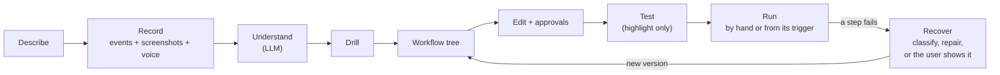

# Shadow

**Shadow learns a work task from watching you do it once, then does it for you, and fixes itself when a site changes.**

You show it a task the way you normally do it (and, if you like, say what it is for). It works out the steps, asks about anything it is unsure of, and from then on runs the task on its own: on a schedule, when a file arrives, or when you start it. Something only you should decide (send this? which file?) waits in an inbox. A changed page is repaired, not a reason to stop. It runs on your Mac, is always on, and keeps its memory and your data there.

Built for the Personal AI track of the [Nebius x NVIDIA Global AI Hackathon](https://nebiusglobalaihackathon.devpost.com/): an always-on, private assistant with persistent memory and reusable skills, running on NVIDIA Nemotron models through Nebius Token Factory.

## What works today

Status on **Oct 13, 2026**. The full design is [`docs/design.md`](docs/design.md) (its [status table](docs/design.md#status-design-vs-code) has the details); [`docs/guide/13-the-whole-picture`](docs/guide/13-the-whole-picture.md) is a one-page map of how the pieces fit.

| Built | Not yet |
| --- | --- |
| **Recording** web pages, Mac apps (Accessibility) and file moves, after a short form (goal, how often, what changes, never), with optional **screenshots** (only the words read on the Mac, masked, leave it) and **narration** (turned into text on the Mac), turned into a workflow by the **design agent** (inputs, loops, branches, LLM steps), with questions on what is unclear | Screenshots and narration tried by a person with macOS's permissions; the design agent tried on the real model |
| **Running** the workflow tree: loops, branches, LLM steps, questions and approvals, in your own Chrome and in Mac apps | **Highlight-only test** play |
| **Recovering** from failures on web pages: classify, repair with cheap fixes or the repair agent (Nemotron 3 Super), keep the fix as a new version, roll back | Repair of Mac-app steps; the fix shown by you recorded as the repair |
| **The inbox**: a run that needs you waits there, even across a restart, and goes on when you answer | |
| **Triggers**: live, paused and draft workflows; schedules; "when a file appears in a folder"; auto-pause after 3 failures | "When an email arrives" |
| **Shadow.app**: menu bar, window (inbox, workflows, runs, versions, Frequency), notifications, the floating Record button | **Editing steps** in the window |
| **The daemon** as a service: local API (socket and HTTP), log files, starting at login from the repo | The **packaged app** (`.dmg`, API key in the Keychain, first-run setup) |

## How it works



1. **Describe.** A short form before recording: **Goal** (required), **Frequency** (becomes the trigger; default: only when you start it), and optionally **What changes each run**, **What stays the same** and **Never**. These answers separate variables from constants, and steps matching Never always wait for your approval.
2. **Record.** You do the task your usual way while Shadow records **events** in Chrome, Mac apps and Finder. With your consent: **a screenshot at each event**, of which only the words read on the Mac (private ones masked) leave it ([how](#privacy)), and **voice narration** turned into text on the Mac (the audio never leaves it).
3. **Understand.** The **design agent** (Nemotron 3 Super in a loop with tools) turns the description, the events, what you said and the masked screen words into a **workflow**: a click on an email becomes "the newest email from this sender", changing values become variables, repeated work becomes a loop, "only if" a branch.
4. **Drill.** Questions only on the steps it is unsure about, shown next to the draft workflow with the step marked; answers go to memory.
5. **Workflow tree.** Each step is a browser or Mac action, or an **LLM step** that transforms data (summarise, classify, read a document). LLM steps never drive the UI. The tree also has **variables**, **loops** and **branches**, and any step can **ask you** something or need your **approval** before it runs.
6. **Edit** *(planned)*. Change any step and toggle **human approval** on any step. Today the window sets a workflow's **Frequency**.
7. **Test** *(planned)*. A **highlight-only** replay shows each target without acting.
8. **Run.** A workflow runs by hand, or on its own once it is **live**: on a schedule or when a file appears in a folder. A workflow that keeps failing pauses itself and tells you. Actions are deterministic; no model call unless an LLM step needs one or a step fails.
9. **Recover.** When a step fails, the failure is classified first: a site that is down is retried later, a login you must do waits for you, an empty inbox ends the run as nothing to do, and only a changed page or app is **repaired**. Repair may change any part of the workflow, but never adds outward actions, changes what you decided or turns approvals off, and is kept only with evidence it worked: then it becomes the **new version**, and you can roll back in one click. If repair can't fix it, the run waits in your inbox: do the step by hand and tell it to go on.

**Components.** One app, **Shadow.app**, on your Mac:

- an always-on **daemon** (Node): workflows and versions, triggers, the inbox, the runs list, memory, and every model call. Today it starts from the repo (`pnpm daemon`, or at login with `pnpm setup:daemon`); packaged, it lives inside the app.
- the **Swift side**: Shadow in the menu bar, the floating Record button, notifications, and Mac-app recording and replay through the Accessibility API;
- the **window**: the inbox, workflows, runs and versions, served by the daemon and shown inside the app.

Outside the app: the **Chrome extension** (web recording and replay through `chrome.debugger` in your own, logged-in Chrome) and a tiny **native-host shim** (Chrome starts a fresh process for every connection, so the shim only forwards bytes to the daemon). There is **no backend server**: the daemon calls Nebius Token Factory directly with your own API key.

**Memory.** Local SQLite in the daemon: drill answers, run context, and site notes from repairs. Never secrets.

## NVIDIA Nemotron on Nebius Token Factory

Every model call goes through `packages/llm` to **Nebius Token Factory**. Callers pick a profile; understanding recordings and recovering from failures are **agents** built on `packages/agent` ([design](docs/design.md#agents)).

| Profile | Model | Used by |
| --- | --- | --- |
| `fast` | **NVIDIA Nemotron 3.5 Lightning** | The workflow's LLM steps on every run: summarise an email, read an invoice, classify a ticket. Cheap and fast ($0.06 / $0.24 per 1M tokens), thinking off, output checked against the step's type |
| `smart` | **NVIDIA Nemotron 3 Super** | Compiling a recording into a first draft; the **design agent** (the description, the recording and what was said into a workflow tree with loops, branches and LLM steps, asking what is unclear); the **repair agent** (works out why a step failed on a changed page, fixes the workflow, verifies, saves a new version) |
| `vision` | GLM-5.3-Flash | Not used yet. Recordings never send pictures, only the words read from them on the Mac; whether the repair agent may send one is open |

Why Token Factory: one OpenAI-compatible API for every profile, structured JSON output with a schema, Nemotron's thinking switched on or off per call, and **Zero Data Retention**, which we require on the account so prompts are neither stored nor used for training. Details, costs and limits: [docs/design.md#models](docs/design.md#models).

## Privacy

- **Everything stays on your Mac** except model calls: workflows, runs, the inbox, memory and logs. No server of ours sits in between, and Token Factory runs with Zero Data Retention.
- **Only text goes to the model**: the recorded events without sensitive values, the failing step and a page outline for repair. Secret values are never logged or sent.
- **Local doors are locked**: the daemon's socket only accepts your macOS user; its HTTP API listens only on `127.0.0.1` and needs a token made at every start, which only you can read ([how](docs/guide/13-the-whole-picture.md)).
- **Risky steps wait for you**: steps that send, submit, pay or delete ask for approval, and repair can never add them.
- **Screenshots and voice**: separate consent for each, on the Record form. Pictures and audio never leave the Mac: only the words read from a screenshot on the Mac (with emails, phone and card numbers, IBANs, API keys and your "Never" words masked) and the narration's text go to the model. Raw recordings are deleted 24 hours after the workflow is saved.

Details: [docs/design.md#consent-redaction-and-retention](docs/design.md#consent-redaction-and-retention).

## Success metric: task coverage

**Task coverage = the share of real workflows that work from a recording of a person doing them their usual way.** The workflows are the 15 in [`docs/examples.md`](docs/examples.md), written from the user's side (what they see, click, copy and type), not as a program would do them.

The test for each one: someone who normally does the task does it while Shadow records, with no instructions on how. Then the next real occurrence runs by itself.

- **1, done:** unattended from its trigger, correct result, three real occurrences in a row.
- **0.5, partly:** correct result when started by hand, possibly with the user doing one step or answering one question.
- **0, not yet:** a core step fails, or a run gives a wrong result (for example a date from the recording replayed as is).

Coverage is the sum of the scores divided by 15. Next to it we track the same scores for skills a developer writes by hand: the gap between the two is what recording and compiling still have to learn.

| Date | Coverage (from a recording) | Hand-written skills | Biggest gaps |
| --- | --- | --- | --- |
| 2026-10-06 | **7%** (1 / 15) | 23% (3.5 / 15) | dates and values that should change but replay literally; "for each" from repeated actions; choosing by sight; text typed from memory; triggers |

These values were **estimated by reading the code** on Oct 6, before the workflow tree, recovery and triggers were built; they have not been measured since. To measure them, have a person who really does the workflow record it, keep the recording in `fixtures/traces/`, and replay on the next occurrence.

## Repository Guide

TypeScript monorepo (pnpm workspaces), plus the Swift app. One language for the extension, the daemon and the window, so they share the same schema and types.

```
.
├── packages/
│   ├── core/          # JOINT   workflow schema and checker, edit operations, repair guard, capability briefing, element descriptor, messages
│   ├── llm/           # JOINT   every model call to Nebius Token Factory: client, profiles (fast, smart, vision), structured output, usage
│   ├── agent/         # JOINT   the agent runtime: loop, tools, guard, budgets, transcript
│   ├── memory/        # JOINT   persistent memory (SQLite, full-text search)
│   ├── ipc/           # JOINT   length-prefixed framing (native messaging + daemon socket), data and log paths
│   ├── recorder/      # RECORD  trace normaliser, compiler, drill questions
│   └── player/        # REPLAY  the workflow interpreter, matcher, channels (web, files, scripts, data, llm steps), repair
├── apps/
│   ├── daemon/        # the always-on daemon: service (runs, inbox), API (socket + HTTP), triggers, lifecycle, store, recording sessions
│   ├── ui/            # the window (React): inbox, workflows, runs, versions, Frequency; served by the daemon
│   ├── mac/           # Shadow.app (Swift): menu bar, window, notifications, Record button, Mac-app capture and replay
│   ├── extension/     # Chrome MV3 extension: background worker (native port, chrome.debugger), content script
│   └── native-host/   # the shim Chrome starts: pipes native messaging <-> the daemon's Unix socket
├── skills/real/       # replay test workflows against real sites (see skills/real/README.md)
├── fixtures/
│   ├── pages/         # local test pages, including drifted redesigns for repair
│   └── snapshots/     # saved copies of the real pages; tests check every locator against them
├── scripts/           # fixture server, installers (native host, daemon at login), Mac app build, sandbox seeder, page snapshots, llm check
├── docs/              # design.md (the design, decisions and status), examples.md (15 real workflows), guide/ (explainers and diagrams)
└── .github/           # CI (lint, typecheck, test, build) and CODEOWNERS template
```

**Who touches what**

| Area | Owner | Rule |
| --- | --- | --- |
| `packages/core`, `packages/llm`, `packages/agent`, `packages/memory`, `packages/ipc`, `apps/ui`, `skills/` | Both | Changes need a review from both sides; the workflow schema is the contract |
| `packages/recorder`, recording code in `apps/extension/src/content.ts` | Record | |
| `packages/player`, replay code in `apps/extension/src/background.ts`, `apps/daemon`, `apps/native-host` | Replay | |

Workspace packages are used as TypeScript source (no build step); the extension, the native host and the window are bundled with esbuild, and Shadow.app is compiled with `swiftc`.

## Running Guide

> These steps run the **current code**, from the repository. The packaged app comes later ([Deployment Guide](#deployment-guide)).

**Prerequisites**: macOS 14+, Node 22+, pnpm 10 (Node ships it through corepack: run `corepack enable pnpm` once), Google Chrome, and the Xcode command line tools for Shadow.app (`swiftc`; `xcode-select --install`).

### 1. Install and check

```sh
pnpm install
cp .env.example .env        # fill in your Nebius Token Factory API key (models are optional overrides)
pnpm llm:check              # checks each model profile with that key: answers, json_schema, tool calls, images (< $0.01)
pnpm build                  # the extension, the native host and the window
```

### 2. Set up once

1. **Shadow.app**: `pnpm setup:mac` builds `apps/mac/build/Shadow.app` (rebuilt only when its sources change). The daemon starts it.
2. **Chrome**: `pnpm setup:native-host` registers the shim with Chrome (`--uninstall` to remove). Then open `chrome://extensions`, enable Developer mode, **Load unpacked** and pick `apps/extension/dist`. Open the extension's Details and turn on **Allow access to file URLs** (without it, upload steps fail with "Not allowed"). The manifest's `key` pins the extension ID to `eloljjdiofhdlhoankjbhfeihjankikk`, the only one the host allows.
3. **Mac apps** (optional): right-click the floating Record button → **Allow Mac apps**, then turn on Shadow in System Settings → Privacy & Security → Accessibility. The permission goes to Shadow only, never to your terminal. After a rebuild, turn it off and on again (the app is signed ad hoc, so the permission is tied to that build; if that doesn't take, run `tccutil reset Accessibility com.shadow.mac`). Without it, web pages and files are still recorded; Mac apps are not.
4. **Notifications**: allow them when Shadow asks.

### 3. Run it

```sh
pnpm daemon                 # in a terminal you can see
```

Shadow appears in the menu bar (how many things wait for you, Record, health, the next run), with the floating Record button at the bottom right. **Open Shadow** from the menu bar opens the window; the terminal also prints a link to open it in a browser. The extension connects within a minute (or reload it).

**Keep it running without a terminal** (optional): `pnpm setup:daemon` starts the daemon at login and again if it stops; it opens Shadow.app. `pnpm setup:daemon --uninstall` stops it; do that before running `pnpm daemon` in a terminal, since only one daemon runs at a time. Logs are in `~/Library/Logs/Shadow` (Console.app shows them).

### 4. Record a task

1. Press the round **Record** button (drag it anywhere), **Record a task** in the menu bar, or **Record** in the window. The window opens the short form: say what the task is for (the goal) and how often it should run, then **Start recording**. Do the task in Chrome, Finder or any Mac app, then press **Stop**. Without Shadow.app, the same button appears inside Chrome pages (and the extension's toolbar icon), and the form's questions come to the Inbox; `record` in the terminal asks them there too.
2. Shadow turns the recording into a workflow and asks its questions: answer them on the **Record** screen, next to the draft, or in the **Inbox** (or type the answer in the terminal; Enter takes the default). The saved workflow appears under **Workflows**.
3. Finder is recorded by what it does to files (moves, renames), not by its clicks. File moves anywhere in your home folder are recorded with no setup (macOS asks once for Desktop, Documents and Downloads when the daemon starts); a folder outside it, such as an external drive, is added when a Finder window shows it.
4. Every recording is saved as its own workflow with its own id, a readable name plus a random tag (`upload-invoice-k3f9q2`), even when you record the same task again, so recordings never overwrite or mix. In the terminal, `run` takes the whole id or just its start when only one matches (`run upload-invoice`). Versions of one workflow (`v2`, `v3`) are its fixes, Frequency changes and rollbacks.

### 5. Run it, and let it run on its own

- **By hand**: **Run now** on the workflow's page, or `run <id>` in the terminal. Web steps run in a separate, unfocused 1280×800 Chrome window (switch to it to watch). If the task used a file, `run <id>` first asks which file to use this time (Enter takes the newest like the one you recorded, or drag a file in), or give it: `run <id> ~/Desktop/new.pdf`. Every file is checked before the first step runs.
- **On its own**: on the workflow's page, set its **Frequency** (every hour, every day at…, weekdays at…, every week, every month, when a file appears in a folder, or a custom schedule) and press **Go live**. **Pause** and **Resume** are next to it; a workflow that fails three times in a row pauses itself and tells you. A workflow you only start by hand can go live too.
- **What waits for you**: an approval (steps that send or submit), a step's question, or a failure only you can fix waits in the **Inbox**, with a notification. Answer there, from the menu bar, or in the terminal (`approve`, `deny`, `resume`, `skip`, `cancel`). It waits as long as needed, even across a restart.
- **Runs** shows every run step by step, with repairs and model cost; a workflow's page shows its versions, and **Roll back** undoes the latest one.

**When a step fails**, Shadow classifies the failure: a site that is down is retried later, a login page waits for you, and an empty inbox ends as nothing to do. Drift (a renamed button, a new banner, an action moved into a menu) is repaired first by cheap fixes with no model, then by the repair agent (Nemotron 3 Super). A fix is kept only when trying it on the live page shows it works, and it is saved as the next version. If no safe fix is found, the run waits in your inbox: do the step by hand in the automation window and choose **I did it by hand: go on**.

### Terminal commands

`pnpm daemon` takes: `record`, `stop`, `compile <session>`, `run <skill-id | skill.json> [name=value … | path]`, `inbox`, `approve`, `deny`, `resume`, `skip`, `cancel [run-id]`, `rollback <skill-id>`, `live <skill-id>`, `pause <skill-id>`, `resume-workflow <skill-id>`, `runs`, `skills`, `traces`, `status`. A question is answered by typing the answer.

### The daemon's API

The window, the menu bar and the terminal all use one API: on the Unix socket (`~/Library/Application Support/Shadow/daemon.sock`, `api.call` messages) and on local HTTP, whose port and token are in `~/Library/Application Support/Shadow/api.json` (readable only by you):

```sh
PORT=$(node -p "require(process.env.HOME+'/Library/Application Support/Shadow/api.json').port")
TOKEN=$(node -p "require(process.env.HOME+'/Library/Application Support/Shadow/api.json').token")
curl -s -X POST http://127.0.0.1:$PORT/api/inbox -H "Authorization: Bearer $TOKEN" -d '{"open":true}'
curl -s -X POST http://127.0.0.1:$PORT/api/answer -H "Authorization: Bearer $TOKEN" -d '{"itemId":"<id>","answer":"approve"}'
```

Methods: `workflows`, `workflow`, `runs`, `run`, `inbox`, `usage`, `health`, `start` (a saved workflow's id, never a file path), `answer`, `cancel`, `rollback`, `state`, `goLive`, `pause`, `resume`, `setTrigger`. `GET /api/events?token=…` streams changes.

### Development

```sh
pnpm test                   # all tests (vitest)
pnpm typecheck              # every package
pnpm lint                   # Biome; `pnpm format` to auto-fix
pnpm ui                     # rebuilds the window on change (reload it)
pnpm extension              # rebuilds the extension on change (reload it in chrome://extensions)
pnpm daemon:dev             # the daemon in watch mode (it also reads Enter, so answer questions in the window)

pnpm fixtures               # serves fixtures/pages on http://localhost:5173
pnpm seed:sandbox           # creates ~/ShadowTest with sample files for skills/real (--reset to start over)
pnpm snapshot:pages         # re-downloads the real pages into fixtures/snapshots
```

**Replay without the daemon**: `pnpm replay` runs a workflow in its own debug-port Chrome (profile in `~/Library/Application Support/Shadow/dev-chrome`), no extension needed. Both paths share the player code.

```sh
pnpm seed:sandbox                                        # once: sample files in ~/ShadowTest
pnpm replay skills/real/fill-web-form.json               # --yes approves gated steps; --headless, --no-scripts, --no-repair, --keep-open
pnpm fixtures                                            # repair on drifted pages: point the drift skill's URL at one of them, then
pnpm replay fixtures/pages/drift/drift-skill.json --yes --input invoice=<a pdf>
```

After `git pull`, run `pnpm install && pnpm build` again, `pnpm setup:mac` if `apps/mac` changed, and reload the extension. The daemon keeps its data in `~/Library/Application Support/Shadow` (runs in `runs/<id>.jsonl`, workflows in `skills/`, the inbox and runs list in `shadow.db`); set `SHADOW_HOME` to use another folder, or `SHADOW_SOCKET` for another socket (at most 103 bytes, a macOS limit).

## Deployed Link

Test build: a GitHub Release with the `.dmg` (Shadow.app with the daemon) and the Chrome extension. Link to be added when the first release is published (milestone 9).

## Deployment Guide

*Planned (milestone 9): until then, use the [Running Guide](#running-guide).* There is no server to deploy: everything runs on your Mac and calls Nebius Token Factory directly.

1. Create a Nebius Token Factory API key and turn on **Zero Data Retention** for the organization.
2. Install the release: open the `.dmg`, drag Shadow into Applications and open it (unsigned, so right-click → Open the first time). It adds itself and its daemon to your login items, so it keeps running after a restart.
3. On first launch, paste the key. It is stored in the macOS Keychain, Chrome is connected to the daemon, and a connection check confirms Nemotron answers. Then load the extension shipped with the app in `chrome://extensions` (Load unpacked) and turn on **Allow access to file URLs**.
4. Allow the macOS permissions it asks for: Accessibility, notifications; Screen Recording, Microphone and Speech Recognition only if you consent to screenshots and narration.

## License

[MIT](LICENSE)
